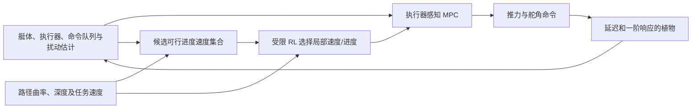

# 推荐主路线：约 15 m/s 高速 UUV 的可行域约束 RL-MPC

日期：2026-11-02。此文件保留原有路径以兼容引用；根据“以约 15 m/s 高速控制为研究主体、用 RL 优化控制器性能”的目标修订研究建议。`AAV-MPC` 终端价值方案仍是备选模块，并非本版的默认主算法。既有实验见 [`aav_mpc/REPORT_20261102.md`](../aav_mpc/REPORT_20261102.md)、[高速实验报告](../high_speed_experiments/REPORT_RL_MPC_20261102.md)和[高速研究方向](../high_speed_experiments/RESEARCH_DIRECTION_20261102.md)。以下方法收益均为待验证假设。

## 一页结论

**研究目标：**在现有 UUV 模型的高速工况，尤其名义目标约 15 m/s 时，研究 RL 如何在执行器迟滞、速度相关舵效、推力/舵角限幅及扰动下，改善 MPC 的路径跟踪、机动完成、约束满足、饱和、航行时间和实时耗时之间的权衡。6 m/s 下的控制失败仍需作为独立的低速子问题解决和评估，但不决定高速 RL 研究是否成功。

**推荐主算法：**执行器状态感知的强 MPC 负责预测、跟踪和显式约束；一个经过闭环检验的**候选可行进度速度集合**限定当前可选的局部参考速度；受限 RL 在集合内根据窗外路径、执行器余量及可观测扰动选择短期速度/进度偏好。RL 的任务是学到曲率规则和短窗优化难以表达的长期权衡，而非直接输出舵角。可行集合及其风险估计若未校准，只能作为启发式筛选，不能称作安全保证。

**首要实证问题：**在名义 15 m/s 的未见高速路径和参数/海流族上，同信息、同任务允许速度范围、同实时预算时，RL-MPC 能否稳定优于固定参考、曲率规则、确定性可行集合选择和 MPC 直接优化速度？若 RL 只能通过明显降速改善位置误差，须同时报告任务航速偏差、完成时间和严格任务违约，不能把这种交换写成无条件性能提升。

**路线边界：**现有高速数据主要来自 18 m/s 压力测试，不能直接推断 15 m/s 的收益。低速 T1 已有确定性 40 步控制器在固定回合修复，其他低速路径仍需单独检验；不能把固定回合当作 RL 成绩。尾段价值 `J_tail/m_tail` 在现有留出工况上失校准，暂不接入高速闭环；待独立校准合格时，才作为第二条 RL 控制接口比较。

## 1. 为什么这样重排优先级

| 现有观察 | 对高速 RL 控制的含义 |
| --- | --- |
| 18 m/s 留出压力集上，固定参考完成 7/8、`curv6` 曲率规则完成 8/8；V3 PPO 残差也为 8/8，但位置 RMSE 约 1.761→1.871 m、饱和占比约 34.3%→37.2%。见[高速研究方向](../high_speed_experiments/RESEARCH_DIRECTION_20261102.md)。 | 曲率规则已是强基线。继续对其调小幅 PPO 残差，尚无明确闭环收益；RL 需要额外的状态、扰动或长期决策信息。样本仅 8 个配对回合。 |
| 固定 18 m/s、曲率限速和增强 condensed MPC 在 [`aav_mpc` 的 T3](../aav_mpc/REPORT_20261102.md) 都有较高仿真完成率，但冻结的严格 18 m/s 任务均为 0/8。 | 路径终点完成与全程满足航速、走廊、姿态界必须分开统计。允许局部变速的研究任务应另行预先定义。 |
| T1 固定 6 m/s 弯道经离线植物复核可行；加长时域与修正终点参考的确定性控制器已解决固定回合。 | 低速失败用于检验控制器适用范围和失败机制；不再作为高速 RL 的阶段门槛。 |
| 全窗执行器模型提高预测一致性，但现有尾段裕度在未见几何的数值覆盖率最高约 52%，随机参数/海流外推更差。见[AAV 阶段报告](../aav_mpc/REPORT_20261102.md)。 | 执行器增强是有用的确定性底座候选；当前 `m_tail` 不满足进入 MPC 的校准门槛。 |

现有植物含 10 个艇体状态、推力/升降舵/方向舵 3 输入，每 0.1 s 控制周期内部有 5 个 0.02 s 子步、指令队列和一阶执行器响应。高速时曲率、深度变化与执行器建立时间共同决定机动余量。代码见 [`simulator/model.py`](../simulator/model.py)、[`simulator/batch_path_env.py`](../simulator/batch_path_env.py)、[`simulator/rti_mpc.py`](../simulator/rti_mpc.py)。当前参数仍是示例仿真参数，尚无实艇外部有效性证据。

## 2. 研究问题、假设与任务定义

**主问题：**给定名义目标约 15 m/s 的高速路径、任务允许的局部速度范围、可观测艇体/执行器状态和路径预瞄，受限 RL 能否选择更好的进度速度策略，使执行器感知 MPC 在未见几何与扰动下取得可重复的闭环增益？任务中的速度范围、变化率、走廊、姿态界和实时预算必须在训练与测试前冻结。

**H1（确定性控制底座）：**全窗执行器/队列预测及统一的路径、姿态、输入约束，较 FSP＋现有 MPC 在高速机动的预测误差、回退或闭环权衡上有收益。该收益属于 MPC 改进，不归功于 RL；预测更准本身不足以证明闭环更好。

**H2（速度可行性接口）：**基于当前状态、执行器余量、未来几何及可观测扰动构造的候选速度集合，能比单纯曲率上限更准确地筛除会导致走廊/姿态/输入失效的进度速度。集合可能有多个连通段或为空；低速端的可控性也须由数据验证，不能硬编码 9 m/s 下限。经验筛选的假可行率必须单独报告。

**H3（RL 独立贡献）：**在同一候选集合和 MPC 底座上，RL 利用长期路径、执行器饱和历史及扰动估计，优于最快可行、最小风险、`curv6` 与无 RL 的短窗速度优化；增益须在独立高速几何和参数/海流族上重复，并对训练种子稳健。若同信息的确定性选择已达到同等表现，则不主张 RL 贡献。

**H4（可选尾段价值）：**仅在 H3 的高层进度接口不足、且独立数据能校准尾段风险时，重新检验执行器条件的 `J_tail/m_tail` 是否进一步改善高速闭环。现有模型未过该门槛，不能直接进入在线 QP。

| 任务层级 | 冻结方式 | 用途 |
| --- | --- | --- |
| **主任务 H15：名义约 15 m/s 高速控制** | 固定名义参考与允许局部调速范围；预先写明航速偏离代价、到达时间、横向/深度走廊、姿态及执行器界。训练、验证、测试按几何与参数族分开。 | 评价 RL 是否在不靠无约束降速的情况下改善高速路径跟踪与机动权衡。15 m/s 是拟定中心工况，具体任务界需在实验前冻结。 |
| **压力任务 H18** | 固定约 18 m/s 压力路径；分开定义严格固定速度任务与允许局部变速任务。 | 研究速度上界附近的推力、舵角和俯仰余量；不得把允许变速的仿真完成记成严格 18 m/s 成功。 |
| **低速子任务 L6** | 保留已冻结的 6 m/s 弯道任务，扩展至其他低速路径与扰动；固定目标速度、走廊和姿态界。 | 解决并检验低速跟踪失败与适用范围；独立报告严格 6 m/s 成功率，不以单回合修复衡量高速 RL 贡献。 |

12 m/s 可作主任务与低速端之间的插值测试；3/6/9 m/s 用于适用范围与迁移分析。不能将全部航速平均成一个数字后掩盖高速收益或退化。现有 18 m/s 上限来自本项目仿真任务设置，并不证明实艇可达到该速度。

## 3. 方法结构

### 3.1 执行器感知的 MPC 底座

用现有 10 状态艇体 `x`、实际执行器 `a` 和待执行命令队列 `q` 构成预测状态 `z=(x,a,q)`；每个控制周期按植物子步更新队列、执行器和艇体。控制器使用可观测/估计的 `a,q` 与公开标称参数，不读取仿真器隐藏随机参数。先比较 FSP＋OSQP/RTI、执行器增强 condensed MPC、同耗时长窗/非均匀时域 MPC；统一命令、实际执行器、姿态与路径的硬/软约束，记录松弛、实际违约、求解回退和周期 95/99 分位耗时。现有 condensed QP 仅有命令盒约束，这项统一工作尚未完成。

### 3.2 候选进度速度集合

对一组候选局部速度或进度率，依据当前艇体/执行器状态、未来曲率和深度变化、指令延迟及可观测参数/海流估计，用短窗预测或优化筛选。判据同时覆盖走廊、俯仰、推力/舵角、速度变化率和任务速度范围；保留不连通的可行候选，集合为空时显式报告并触发预定义退路。先用确定性标称/参数集合实现；若扰动预测的校准有独立收益，再加入场景或误差界。此集合是模型条件的经验可行性估计，需用实际闭环的覆盖率与假可行率检验，不自动构成形式安全证明。

### 3.3 受限 RL 控制接口

Actor 观察艇体误差与速度、实际执行器及队列、候选集合及置信度、窗外几何摘要、可观测扰动估计和上次参考；输出局部速度/进度偏好，经候选集合投影与变化率限制后交给 MPC。训练回报分别计入原名义航速偏差、路径误差、完成时间、能耗代理、执行器饱和与任务违约；失败回合保留。评估时冻结奖励权重与任务界，并做无投影、无扰动输入、无执行器输入及无长期几何输入的消融。投影不足以保证闭环安全；MPC 约束、回退与植物违约必须另计。

现有 V1–V3 PPO 仅调参考或在 `curv6` 上加残差，未证实优于强规则。新实验必须先证明候选集合具有判别力，再检验 RL 是否利用了曲率规则以外的信息；不要以更长训练或重复调奖励代替机制检验。

### 3.4 条件性扩展：尾段价值与扰动预测

若高层速度接口仍受短 MPC 预测窗限制，可重新训练末端 `z_N=(x_N,a_N,q_N)` 与窗外路径条件下的长期任务代价 `J_tail`，以及在生成标签的后续策略下的尾段约束裕度 `m_tail`。它们不是全控制序列的可恢复性证明。现有尾段裕度在未见几何和随机海流上失校准；必须先有独立数据上的排序、低分位覆盖和假安全率，再考虑候选重排序或 QP 局部近似。失校准时禁用学习项，保留强确定性底座。

条件 diffusion、GRU 或其他扰动预测器是可替换组件。现有稳态海流和简单过程噪声不足以证明复杂分布模型有用；仅在留出的非平稳/间歇扰动家族上，预测校准、闭环性能和实时成本都胜过持久值、AR/卡尔曼等简单方法时才加入。相关先例和场景边界见[高速研究方向](../high_speed_experiments/RESEARCH_DIRECTION_20261102.md)。

## 4. 对照、实验顺序与判据

1. **冻结高速任务。** 构建名义约 15 m/s 的路径族：恒曲率、S 弯、不同入弯长度、螺旋/深度反转和复合机动；独立留出几何家族、艇体/执行器参数族和稳态/非平稳海流族。预先固定允许速度范围及原任务的计分方式。沿用 H18 压力集作外推检查；L6 作为单独的低速控制子任务报告。
2. **确定性控制基线。** 统一约束和求解预算，配对比较固定名义速度、固定较低速度、`curv6`、FSP＋OSQP/RTI、执行器增强 condensed MPC、同耗时长窗/MPCC；先验证候选速度集合与最快可行、最小风险和 MPC 网格速度优化。低速旧结果用于发现机制，不决定此阶段去留。
3. **受限 RL 训练与消融。** 用独立训练几何、参数、海流族和多个训练种子，训练在同一候选集合上选速度的 actor；留出测试只运行冻结模型。对照无集合的 RL、曲率规则残差 PPO 和无 RL 选择器，区分收益来自集合、MPC 还是 RL。
4. **尾段学习门槛。** 只有高速主任务仍有明确的窗外准备缺口，且新的 `J_tail/m_tail` 在独立几何与扰动上通过风险校准，才加入 AAV-MPC 价值对照；同时比较人工终端项、同耗时长窗和 ZipMPC 式蒸馏。

至少报告按任务、航速、几何和扰动分层的仿真完成与**严格任务完成**、首次违约类型、假可行率及配对置信区间；共同成功回合报告位置/航速 RMSE、95 分位误差、完成时间、能耗代理、执行器饱和、求解回退和周期 95/99 分位耗时。能耗代理不能称为电池能耗。每条测试几何应有多个配对参数/扰动种子，同一方法重复训练种子；现有 8 回合高速结果仅用于选择机制。

**RL 成功判据：**在未见的约 15 m/s 高速任务族中，受限 RL 相对同一候选集合上的最强非 RL 速度选择器和 `curv6`，取得可重复的严格任务完成或误差–时间–饱和 Pareto 改善，且计算延迟满足 0.1 s 周期预算；移除 RL 长期信息后收益消失。若只是通过降低实际航速换取精度，必须作为明确的速度–精度权衡报告。若没有独立增益，保留确定性高速 MPC 与可行速度集合成果，不声称 RL 创新。

## 5. 文献关系与外部有效性

短窗规划加学习终端价值已有 [TD-MPC（ICML 2022）](https://proceedings.mlr.press/v162/hansen22a.html)，长窗行为压缩已有 [ZipMPC（CoRL 2025）](https://proceedings.mlr.press/v305/rickenbach25a.html)，actor 调 MPC 参数已有 [Actor–Critic MPC（T-RO）](https://rpg.ifi.uzh.ch/docs/TRO25_ACMPC_Romero.pdf)，强路径约束 MPC 可参考 [MPCC++（RSS 2024）](https://www.roboticsproceedings.org/rss20/p109.html)。速度–曲率规则和 AUV 扰动预测也有先例，见[高速研究方向](../high_speed_experiments/RESEARCH_DIRECTION_20261102.md)。本路线不能把“RL 调参考”“接一个价值网络”或“曲率限速”单独写成创新；新增价值须由高速欠驱动艇的执行器状态、双侧可行速度、扰动条件与长期决策的联合机制及强对照证明。

当前水动力和执行器参数是示例仿真，任务上限 18 m/s 不等于实艇可达速度。若要主张实际 UUV 高速性能，还需独立辨识参数、执行器状态估计误差、硬件在环、水池或实艇证据；当前结果不提供形式安全保证。

## 6. 下一轮具体工作

1. 冻结 H15 主任务的名义速度、局部调速范围、速度偏差代价、路径走廊与姿态界，并建立与 H18/L6 分开的报告口径。
2. 在相同约束与 0.1 s 周期预算下复核 FSP＋OSQP、`curv6` 和执行器增强 condensed MPC 的 H15 配对表现，定位尚有增益空间的高速工况。
3. 实现并校准候选进度速度集合；在未见高速路径上先比较最快可行、最小风险和无 RL 网格/MPC 选择。
4. 仅在集合有闭环判别力且强规则仍有可解释缺口时训练受限 RL，并用独立几何、参数和海流族证明增量收益。
5. 根据校准结果决定是否重启 `J_tail/m_tail`、非平稳扰动预测或 diffusion；每个模块单独消融并计入实时成本。

若 H15 主任务中的强确定性方法已充分解决问题，应设计更能暴露长期决策权衡的**高速**留出任务，而不是回到单条 6 m/s 弯道反复调参。论文题目与“安全”“可恢复性”等措辞应以最终闭环证据确定。
