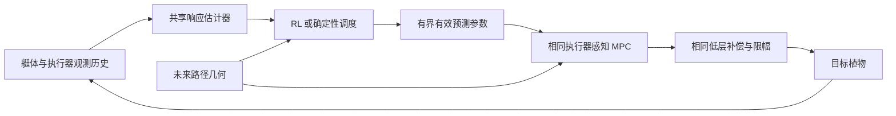

**高速 UUV：MPC 基线证据与 RL 创新方向建议**

2026-11-03 · GS-8 · 分析版本：仓库 `07c059e0658b426ff7b95a2362de786bd8f25811`

**建议优先研究“历史响应与机动阶段驱动的 MPC 预测模型自适应”，让 RL 学习何时采用更保守的执行器预测。** 第一版保持 15 m/s 参考，只输出一个连续、有界的调度量；底层使用执行器感知 MPC，并与在线观测器、自适应 MPC 和确定性调度直接比较。现有结果对这条路线的支持，比对舵角残差、终端价值或复杂海流预测更强。

这是一条待验证的研究假设，目前没有 RL 收益证据。建议先做小规模判别实验，确认“动态调度比充分调优的固定先验有额外空间”，再训练 RL。**不必等 MPC 在全部随机任务上达到 100% 成功才研究 RL；但必须先排除评价错误、明显缺失的模型状态和过弱的确定性对照。**

本文核对了指定实验计划、最终报告及相关实现，补充核验了六篇一手文献。历史完成数与耗时均引自报告；本次 checkout 的 `outputs/experiments/` 只有占位文件，未取得原始逐周期结果，也未重新运行这些实验。因此下文区分报告证据、代码事实和拟议实验，不把已有报告当作本次独立复现。

**1. 基线结果真正指向什么**

| 已有证据 | 对研究方向的影响 | 不能由此推出的结论 |
| --- | --- | --- |
| 受控开发集 N40 从 0/20 到末端延拓后的 17/20；压力开发为 18/20 | 末端参考延拓应成为全部对照的共同配置 | 这部分收益不能计入 RL，也不能称长时域学习解决了失败 |
| 压力测试 OSQP N20、N40 均为 33/40；condensed N40 为 37/40，但最大回合 p99 达 116.7 ms | 长时域有收益与代价，需要同计算预算比较 | 增大 N 不必然更好，也尚未证明主要问题是短窗近视 |
| 四条耦合复制路径：源域 29/40；只改舵效为 10/40；只改二阶执行器为 11/40；两者组合为 4/40 | 舵效与响应结构失配是当前最有证据的研究轴 | 不能把两项影响线性相加，也不能把所有海流条件都排除 |
| 同组消融中仅谐波海流、仅积分器变化均为 29/40 | 暂不优先投入 diffusion 海流预测 | 只适用于这次扰动幅值与家族，不代表真实海况无影响 |
| 固定预测先验 `.85 gain / 2× tau`：新耦合几何 0/20→14/20，非耦合回归双方 10/10 | 必须把该先验纳入强基线；低维预测参数具有闭环影响力 | 70% 不是安全保证；四条路径全部来自同一 coupled 生成族，主要是族内参数变化 |
| 硬约束测试 34/40、219 次回退；软约束 34/40、7 次回退且出现约 157° 预测俯仰松弛 | 约束表达、可解性与实时性要共同处理 | 网络外层不能自动把当前控制器变成安全 MPC |
| 固定目标、无流无噪声找到可行命令；完整扰动下有限时间搜索未找到合规候选 | 应把可行性分成已找到解、尚未知两类 | 搜索超时不是不可行证明；无扰动解也不是扰动鲁棒证书 |

最值得关注的是“为什么一个固定保守模型如此有效”。开发小样本中 `.85/2.0` 为 4/5，报告称已知系数 oracle 的 `.90/1.69` 为 2/5。后者仍属于一阶预测模型对二阶目标响应的等效校正，并非完整真实目标模型。因此这不足以证明“错误模型优于真实模型”，但提示：**对有限时域、近似求解的 MPC，闭环最好的有效预测参数未必等于最小预测误差对应的参数。** 这正是 RL 可研究的地方，也已有明确文献先例，不能单凭此提出新颖性。

高速特色应落实到可检验的物理机制：舵效按纵向速度平方变化；迟滞在高速下转化为更长的前进距离；水平与垂向机动通过艇体动力学和速度产生耦合，是否造成共同控制余量下降仍需验证。它们说明为何应联合考虑速度、实际舵状态、历史响应和未来几何，但不直接证明 RL 必要。15 m/s、N35、0.1 s 的名义预测距离约为 52.5 m，可用来解释预瞄覆盖，不应当作实际可达距离。

**2. 代码核对带来的关键修正**

| 代码事实 | 后续研究必须采取的做法 |
| --- | --- |
| `aav_mpc/h15_target_domain.py:22` 的二阶执行器保存内部 `rate`；`aav_mpc/controller.py:21` 的 22 状态输入只有艇体、实际执行器和三条队列，没有响应变化率。二阶更新实际覆盖推力和双舵三个通道 | 使用历史观测或二阶响应观测器；先做推力/双舵通道消融，不能把二阶模型敏感性全部归于舵机。各方法获得同样信息，不读取仿真器隐藏 `rate` |
| `simulator/rti_symbolic.py:109`、`:139` 将 gain/tau 写入 CasADi 函数构建结果 | 在线参数应成为数值函数输入。直接改 Python 属性不会改变已有动力学函数；控制周期内重建符号函数不可作为默认实现 |
| `aav_mpc/condensed_mpc.py:84` 只有命令盒约束；`aav_mpc/diagnose.py:135` 的路径约束只接多重射击 RTI | 现有强保守 condensed 与有路径约束的 RTI 不是同一底座。RL 和非 RL 应使用相同约束实现，避免把新增约束的收益归给 RL |
| `simulator/ddat_env.py:195` 在零策略动作下仍做扰动补偿；实际发出命令可能不同于 `base_command` | 当前基线并非只有裸 MPC。保留相同补偿器，并单独消融，避免学习模块重复补偿或掩盖补偿器失配 |
| `aav_mpc/diagnose.py:188` 用 `base_command` 做一步预测，`:192` 才读取实际 `info['command']` | 新的 `prediction_1_*` 仍不在所有状态下等于“实际发出命令的预测误差”。先按保存的 pre-state、queue 与实际命令离线重算；代码差异本身不能量化历史误差偏差 |
| `aav_mpc/h15_robust_prediction.py:47` 的 `common_success_position_rmse_mean_m` 按各方法自己的成功回合取均值 | 后续按 `(path, seed)` 取两方法共同成功交集。非耦合 10/10 对 10/10 时集合一致，但其他比较不能依赖该字段名称 |
| `aav_mpc/diagnose.py:317` 的严格成功排除了求解回退及任务边界违约，但未将单周期计算超期纳入判据；任务边界在每 0.1 s 控制周期末记录。耗时仅围绕 `env.step` 计量 | 回合超时本身已使仿真无法成功；另报全流程计算超期率及联合任务合格率，计入估计、策略、参数更新、优化与输出。控制周期采样合格也不证明全部积分子步合格 |

报告的最大回合 p99 为 99.79 ms，只比 100 ms 低 0.21 ms，而且它是分位数而非最坏执行时间。现阶段不宜假设“再加一个小网络几乎没有成本”。代码每步还重新创建 OSQP；缓存结构、参数化动力学等确定性计算改进应对全部方法共享。

预测残差还需区分艇体/执行器失配与海流：当前符号预测的位置方程没有显式海流输入，而植物积分有海流。新估计器不能把全部位置残差都解释成舵效变化；应同时检查执行器、角速度的多步残差，并统一海流估计/补偿口径。

航速评价也需固定定义：`simulator/batch_path_env.py:261` 用旋转后的艇体速度沿路径切向投影减目标速度，并未在该表达式显式加海流；不能把它与艇体速度模长或对地速度混用。主实验继承既有指标，若增加对地速度就单独列示，不悄悄改变成功判据。

**3. 候选方向排序**

| 顺序 | 方向与 RL 角色 | 证据与启动条件 | 主要风险 |
| --- | --- | --- | --- |
| **主线** | 历史响应条件下的预测模型保守度调度：RL 选择有效模型的保守程度 | 当前最强证据是 gain/tau 与执行器结构失配；先证明调度优于最佳固定参数 | 完全被在线观测器或简单阈值调度替代；普通 RL 调参缺少创新 |
| **备选 A** | 预算约束的预瞄/计算调度：RL 决定何时增加远端几何信息或计算投入 | 模型修正后仍有事件相关的提前准备不足，且同预算非均匀时域不能解决 | N 越长不一定越好；实时尾部恶化；事件触发 MPC 已有大量工作 |
| **备选 B** | 连续参考速度微调：RL 分配有限的速度与机动余量 | 固定任务下剩余问题确实与进度安排相关，且任务允许局部变速 | 依靠长期降速获得误差改善；旧速度策略不满足 H15 约束 |
| 暂缓 | 执行器条件终端价值 | 先证明失效来自窗外几何，且价值在独立几何/参数上校准 | 已有尾段模型 OOD 失败；短窗+价值已有 TD-MPC、ZipMPC 先例 |
| 暂缓 | 直接舵角残差、全权重 RL、diffusion 海流预测 | 需分别证明现有接口不足、低维接口无效或简单预测器失效 | 归因困难、计算负担高，当前消融没有给出优先依据 |

本轮不建议沿用旧文献报告中的“候选速度集合”作为主线。指定实验计划已明确不使用该方案；当前主要证据也更指向响应失配。连续速度若成为后续备选，应单独研究，不与主线的预测参数调度同时训练。

**4. 主线如何成为一个明确的 RL 问题**

研究问题可以表述为：**在 15 m/s、固定实时预算下，面对未见舵效和执行器响应变化，策略能否利用近期响应及未来耦合机动，选择比固定保守先验和确定性自适应 MPC 更好的有效预测模型？**

先建立一个所有方法共享的历史响应估计器。输入是过去 1–2 s 的发出命令、实测/估计执行器、艇体速度与角速度，以及因果可得的预测创新；输出有效舵效、响应时间和估计不确定度。1–2 s 是待在开发集选择的起点，不是已证实最优窗口。二阶结构需与显式二阶观测器比较，不能指望单一一阶 tau 代表全部隐状态。

RL 第一版只输出一个标量 `λ∈[0,1]`，在“固定保守先验”与“在线估计的有效参数”之间调度：

```text
θcons = (0.85, 2.0)                       # gain、tau 的无量纲缩放
θest  = 共享估计器对当前有效响应的估计
θpred = (1 − λ) θcons + λ θest
λt    = 投影和变化率限制后的策略输出
```

以 0.5 s 更新一次高层策略、0.1 s 更新 MPC 可作为首版实现起点；同时用相同更新频率比较确定性调度。参数边界、估计置信不足时的处理及变化率上限只由开发/验证集选定并冻结。若只有一个标量无法覆盖 gain 与 tau 的不同作用，再由消融支持扩展到两个参数，不同时增加速度、时域和代价权重输出。

这里 `λ` 是**闭环性能与保守性的偏好**，不是概率或统计置信度。参数的凸组合不意味着闭环安全也能插值；`.85/2.0` 自身只有 14/20，回到该点只是确定性退路，不能称安全回退。若估计器能预测更完整的二阶响应，两个端点需采用同一参数化结构，不能直接混合不兼容模型。

策略观察还包括跟踪误差、当前速度、实际舵/队列、估计不确定度、近期饱和与 QP 状态、上次 `λ`，以及前方曲率/深度坡度和距离下一机动事件。可在开发集试验 0–60 m 几何预览。全部确定性对照也必须获得相同历史和路径信息；不使用未来扰动、测试路径 ID、目标真参数或隐藏执行器状态。



训练目标应对应整段任务：完成奖励，归一化横向/深度/航速/俯仰误差，实际饱和及命令变化，参数抖动、求解失败和计算超期。可用现有 PPO 工具做首版低维策略；是否用 PPO/SAC 不是创新点。约束惩罚不能替代实际违约统计，RL 也不允许放宽任务边界或用降低成功标准换回报。

主任务保持 15 m/s 参考，评价仍按原任务航速容差 ±2 m/s、横向 ±8 m、深度 ±5 m、俯仰 ±40°。如后续采用速度备选，单独冻结参考 `[13,17] m/s` 与变化率 `0.5 m/s/s`，按 0.1 s 周期即最大每步变化 0.05 m/s；实际航速仍相对原 15 m/s 评价。旧 `train_reference_policy.py:95` 的 `[9,18]` 和 `.7/.3` 滤波不能直接复用。参考位置推进、速度向量与终点延拓必须使用一致的调度速度，避免重新引入追赶或终点伪故障。

**5. 最小判别实验：先证明有值得学习的选择**

建议按下列顺序推进；这是下一阶段方案，本次没有执行训练或新闭环实验。

| 阶段 | 最小工作 | 继续/停止依据 |
| --- | --- | --- |
| P0：评价与底座对齐 | 核对实际发出命令的预测、共同成功交集和完整周期计时；复现 `.85/2.0`；做推力/双舵二阶响应消融，并比较显式二阶观测器与一阶等效估计 | 若主要缺口来自推力响应，先调整预测接口；若底座修复已消除缺口，就重新定义 RL 问题，不保留人为过弱对照 |
| P1：调度潜力筛查 | 至少四个耦合开发变体×五个配对种子；比较最佳固定参数、`.85/2.0`、在线估计，以及离线搜索的有界分段调度 | 离线有界调度在相同任务边界下也没有有意义收益，则暂停该接口；有限搜索失败只说明未找到，不证明所有策略无效 |
| P2：RL 必要性 | 同一估计器、同一 MPC 比较确定性调度与标量 RL；至少三个独立训练种子 | 仅超过原始 N35 不够，必须超过开发/验证阶段选出的最强可部署确定性方法 |
| P3：冻结后测试 | 新几何、未见参数组合与时变响应；控制周期串行测量；独立实现的目标模型作为外部验证 | 改善需在不同几何和目标工况复现；不能只对同一 coupled 生成器改几个参数就称跨家族泛化 |

P1 可把名义先验 `(1,1)`、已有 `(.85,2)` 纳入小网格，在开发集选择有效 gain/tau 范围；不建议把一个任意大网格当成物理可信参数集。离线分段调度可以看到未来作为诊断对照，但必须标记不可部署，且只是找到的候选，不是严格最优上界。只有它相对固定先验有空间，才值得问策略能否从因果历史中学到该调度。

最小正式控制器集合建议为：

1. 末端延拓的 OSQP N20 与原 condensed N35，保留历史参照。
2. 固定 `.85/2.0` 与相同调参预算下的最佳固定预测参数。
3. 确定性响应观测器/辨识器＋MPC，包括显式二阶响应对照。
4. 同一估计器＋确定性置信/创新阈值调度；阈值必须经过验证集调优。
5. 同一估计器＋RL 标量调度。

再做四项消融：去历史、去未来几何、固定 `λ`、去调度变化率限制。若观察器单独就取得全部收益，结论是模型估计改善，不能写 RL 改善；若去未来几何不影响结果，不能把“提前为耦合机动准备”作为方法解释。监督历史网络可以作为估计器对照，但不能把监督学习本身写成 RL。

建议最终至少使用 **8 条新路径×10 个配对植物/扰动种子**，涵盖现有耦合族参数留出及至少一个未用于训练的几何组合族；另留非耦合回归。域条件至少分别报告：源域、静态失配、未见参数组合、运行中响应变化、观测噪声/延迟，以及独立模型验证。响应变化应有物理合理幅值与平滑时间尺度，不能只人为制造适合策略的突变。

每个域的 80 单元在全部控制器之间配对；RL 对每个训练种子单独评估，不把三个训练种子跑在同一 80 单元上当成 240 个独立植物样本。原复制集和本次已读出的修复留出集可用于诊断/回归，今后调参后不能再称新的最终留出。

预先登记主要门槛：相对最强确定性对照，严格完成率至少提高 **10 个百分点**（沿用 H15 配置的最小效应量），并报告配对不确定区间与改善/恶化数；若区间太宽则扩大测试。几何及共享种子带来相关性，应采用考虑路径与种子分组的重采样或分层模型，不能对控制周期逐点 bootstrap。若已接近完成率上限，则另预注册不降低完成率的误差/饱和/耗时收益，不在看到测试后临时换主指标。

全量回合先报告首次违约、完成率、进度及超期率；位置/航速 RMSE 在共同成功交集比较。饱和与能耗代理应分开；未经校准的控制量平方不能称实际能耗。实时性给完整控制流程的 p50/p95/p99、最大观测耗时及 `T>100 ms` 比例，并检验发生超期时实际采用的控制时序，不能只测快速网络的推理时间。

随机目标域可行性无需在所有海况中先被形式证明，但应分层：已有可行见证的单元用于证明控制改进；未知可行性的单元作为压力集并明确标签。已知未来扰动的离线候选可辅助判别，不能作为在线方法公平性能基线，更不能把找不到候选标成不可行。

**6. 文献边界：哪些已经有人做过**

以下为本次从作者/会议一手页面核验的相关工作；这是针对本路线的先例核对，不是穷尽检索，也不构成“首次提出”证明。

| 文献与一手来源 | 已覆盖的思想 | 本项目需要多做什么 |
| --- | --- | --- |
| Gros、Zanon，*Data-Driven Economic NMPC Using Reinforcement Learning*，IEEE TAC 65(2):636–648，2020；[作者版本](https://arxiv.org/abs/1904.04152)，DOI `10.1109/TAC.2019.2913768` | 用参数化 NMPC 表示策略并通过 RL 优化闭环性能；控制用模型参数不必等同于真实系统辨识参数 | “RL 学 gain/tau”或“预测最准不等于控制最好”本身不是新贡献 |
| Węgrzynowski 等，*Beyond Constant Parameters: Hyper Prediction Models and HyperMPC*，CoRL 2025；[会议页面](https://proceedings.mlr.press/v305/wegrzynowski25a.html) | 基于历史及预期控制，预测沿时域变化的模型参数 | 单纯加入历史网络或时变模型参数缺少区别；要证明执行器隐状态、闭环保守度调度及高速耦合条件下的独立作用 |
| Wabersich、Zeilinger，*A Predictive Safety Filter for Learning-Based Control of Constrained Nonlinear Dynamical Systems*，Automatica 129:109597，2021；[作者版本](https://arxiv.org/abs/1812.05506)，DOI `10.1016/j.automatica.2021.109597` | 在模型、误差界及可行性等假设下，用预测过滤器约束学习控制输入 | 简单参数限幅、固定先验回退没有继承其安全结论；若主张安全需单独建立并验证对应假设 |
| Hansen、Su、Wang，*Temporal Difference Learning for Model Predictive Control*，ICML 2022；[会议页面](https://proceedings.mlr.press/v162/hansen22a.html) | 学习动力学与终端价值，结合短窗轨迹优化 | 终端 critic 不是独立创新，且本项目现有 OOD 校准缺口必须解决 |
| Rickenbach 等，*ZipMPC: Compressed Context-Dependent MPC Cost via Imitation Learning*，CoRL 2025；[会议页面](https://proceedings.mlr.press/v305/rickenbach25a.html) | 通过模仿学习压缩上下文相关的 MPC 代价，学习长时域行为 | 若选择预瞄/终端价值路线，应与这种压缩方案比较；不能误称 ZipMPC 为 RL |
| Krinner 等，*MPCC++: Model Predictive Contouring Control for Time-Optimal Flight with Safety Constraints*，RSS 2024；[会议页面](https://www.roboticsproceedings.org/rss20/p109.html) | 路径安全约束、终端安全集、模型残差与贝叶斯调参组成强控制基线 | 路径进度、模型修正和调参都已有先例；贝叶斯调参不是 RL，飞行器结论也不能直接移植到 UUV |

目前可争取的贡献是一个具体、可证伪的组合：**在缺少执行器内部响应状态的条件下，利用历史观测和未来耦合几何，学习具有时间连续性的有效预测模型调度，在相同信息与实时预算下改善高速 UUV 的未见响应变化适应能力。** 必须用同信息的二阶观测器、确定性调度、HyperMPC 类模型参数预测来判断学习控制是否额外有用。换应用对象、加 PPO 或将两个现有模块拼接，不足以单独支撑方法创新。

论文题目可暂定为“面向高速 UUV 耦合机动的历史响应条件预测模型调度与强化学习 MPC”。在尚未完成独立模型或硬件验证之前，不把“安全保证”“实艇泛化”或“sim-to-real”写进主张。当前模型参数包含示例失配，目标域仍共享水动力方程；15 m/s 是仿真任务设定，不是实艇能力证明。

**7. 下一步建议与决策出口**

最先值得投入的是 **P0＋P1 的小规模判别实验**：校正预测与评价口径，补上二阶响应状态估计，对比最佳固定先验、在线估计和有界分段调度。这比立即长时间训练 PPO 更能判断论文路线是否有空间。

若动态调度确有额外收益，就进入单标量 RL；若在线估计已覆盖收益，则接受确定性 MPC 的结论，并重新寻找尚未解决的长期决策问题；若主要剩余问题是实时预算下的远端机动准备，则转向预瞄/计算调度；只有任务进度安排确有必要时，才启动独立的连续速度路线。每个出口都保留负结果，不以一定要用 RL 为理由弱化对照。

**资料定位**

- [指定实验计划，固定提交版本](https://github.com/HewayofRevachol/uuv_highspeed_control/blob/07c059e0658b426ff7b95a2362de786bd8f25811/docs/basline_experiment_plan.md)
- [H15 阶段诊断最终报告，固定提交版本](https://github.com/HewayofRevachol/uuv_highspeed_control/blob/07c059e0658b426ff7b95a2362de786bd8f25811/aav_mpc/H15_BASELINE_FINAL_20261103.md)
- 本文所有代码位置均相对上述提交；历史数值来自该报告第 2–6 节，计划未完成项以第 8 节为准。
- 本次仅交付分析和实验建议，没有修改控制代码、启动 RL 训练或生成新的性能结果。
