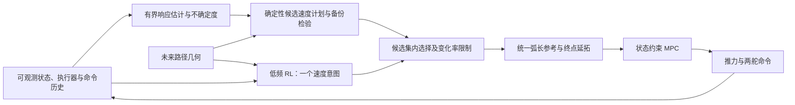

# 从 H15 MPC 失效机制出发：跨领域 RL 方法与可检验创新方向

检索与核查日期：2026-11-04。本文是文献与方案研究，没有新增训练或闭环结果。建议优先研究**“执行器响应不确定度条件下的参考速度治理与长期决策”**：先建立有界在线估计、状态约束和确定性参考治理，再判断 RL 是否能在同一个可行候选集合上取得独立收益。备选是受预算约束的短窗 MPC 加终端价值；直接舵角残差和 diffusion 扰动预测暂不列为主线。

这比“RL 调参考速度”更具体，但仍是**候选研究命题**。参考治理、预测安全过滤、历史适应、RL–MPC、学习终端价值以及 AUV diffusion–MPC 均有先例；模块拼接不能自动成立为论文创新。本次新增的价值是把这些先例的真实假设与 H15 的失配、约束、观测和计算边界逐项对齐，并给出能够否定方案的实验。

## 1. H15 究竟需要解决什么

证据基座是用户指定的 `aav_mpc/H15_MPC_RL_OPPORTUNITIES_20261104.md`，并核对了 `H15_BASELINE_FINAL_20261103.md`、H15 配置及控制/评价代码。历史数字仅转述原报告，不冒充本次复算。

| 当前证据 | 对选题的约束 |
| --- | --- |
| 目标域耦合路径：原 N35 为 4/40；舵效和二阶执行器单独改变也显著退化 | 先研究执行器响应与模型失配。不能把全部失败统称为 MPC 短视或 RL 表达能力不足 |
| 新修复留出：固定保守预测 `.85/2.0` 的 N35 从 0/20 到 14/20；仍有 2 俯仰、2 航速、1 深度、1 求解首次失败 | 它是必须超过的主基线；先修估计和约束产生的收益不能归功于 RL |
| 保守 N35：p95 中位数 45.84 ms、最大回合 p99 99.79 ms | 100 ms 只有统计意义上 0.21 ms 余量；复杂预测器、多个候选 QP、策略和过滤器都须重测整周期 |
| 当前 condensed QP 主要约束命令盒；另一 RTI 加硬路径约束仍有大量回退 | “由 MPC 输出命令”不构成状态安全保证；MPC 必须处理实际执行器、状态边界和不可行恢复 |
| 18 m/s 旧任务三版 PPO 未明确超过曲率规则；H15 任务与其不同 | 不能沿用旧成功率、9–18 m/s 动作范围，也不能用 PPO 本身作为创新 |
| 随机目标域全程可行性未决，两域共享水动力方程 | 找不到解不等于无解；当前迁移不能支持独立物理模型或实艇泛化结论 |

**两个需要在下一轮修正的评价细节。** `simulator/batch_path_env.py:244` 中的原航速误差是 \(e_v=t(s)^T R(\eta)v_{body}-15\)，不是艇体速度模长。`aav_mpc/diagnose.py` 每 0.1 s 审计 H15 严格阈值；内部 0.02 s 子步仅有较宽松终止保护。未来同时保存旧口径和新增子步严判，所有基线一起重评。新子步结果不得与历史 14/20 直接拼成提升。实际执行器状态目前由仿真器提供，实艇还需相应传感器或估计器。

## 2. 检索口径与“一区”的定义

本次按用户要求作面向问题的跨领域方法扫描，使用指定 [ARS-Codex](https://github.com/Imbad0202/academic-research-skills-codex/tree/a1556557887f345aac99bdc6027e008e91fef236/skills/academic-research-suite) 的 `three-way-scan`，逐篇记录 WHY/HOW/WHAT、阅读范围、证据与迁移条件。查询覆盖 `AUV reinforcement learning path following`、`actuator delay robust adaptive MPC`、`agile flight reinforcement learning MPC`、`history adaptation`、`predictive safety filter`、`reference governor`、`terminal value MPC`；再对已知近邻追踪正式出版页、作者稿与 DOI。采用 DOI/题名去重，2021–2026 工作为主，保留 2005/2017/2018 控制基础文献。

共形成 **17 篇内容证据卡＋1 篇仅核对元数据的综述指针**。其中主表 10 篇满足本次采用的“2025 中科院升级版大类 1 区期刊，或 RSS/CoRL/ICML 顶会”筛选；其余为明确标注的控制理论基础和海洋同域补充。**顶会不套用期刊分区。** 这不是系统综述的全量命中数；搜索引擎超时、部分出版页 403/429，检索更多依赖精确题名、正式论文页和公开作者稿，不能据此证明不存在近邻。

延续仓库已有文献报告的口径，优先采用 **2025 中科院升级版“大类”1区**，不把 JCR/SJR Q1、CAS 小类1区或2026新锐版混用。下列分区由公开二次转录核验，**未登录官方分区库认证**；保留年份、学科和链接供复核，不能用于自动认定某机构的考核资格。

| 主表期刊 | 2025 中科院升级版大类 | 来源 |
| --- | --- | --- |
| Nature | 综合性期刊1区 Top | [公开分区页](https://www.sci365.cn/journals/nature-00280836/) |
| Science Robotics | 计算机科学1区 Top | [公开分区页](https://www.sci365.cn/journals/science-robotics-24709476/) |
| IEEE Transactions on Robotics | 计算机科学1区 Top；机器人学小类为2区，不能混写 | [公开分区页](https://www.sci365.cn/journals/ieee-transactions-on-robotics-15523098/) |
| IEEE/CAA Journal of Automatica Sinica | 计算机科学1区 Top | [公开分区页](https://www.sci365.cn/journals/ieee-caa-journal-of-automatica-sinica-23299266/) |
| IEEE Transactions on Cybernetics | 计算机科学1区 Top | [公开分区页](https://www.sci365.cn/journals/ieee-transactions-on-cybernetics-21682267/) |

Automatica、IEEE TAC、Ocean Engineering 在所查 CAS2025 大类为2区；其 JCR Q1 不能替代大类1区。Applied Ocean Research 的海洋学小类1区也不等于大类1区。这些期刊的相关工作仍有必要作为理论与同域对照，但不计入上述10篇主表。

## 3. 最值得读的10篇：方法、证据与迁移接口

所有“H15用法”均是本报告提出的迁移假设；原文没有验证本项目的 H15 控制器。选读作者稿与最终出版物存在版本差异时，明确标出，不把预印本内容自动等同于正式版本。

| 编号、论文及出处 | WHY / HOW / WHAT：原文证据 | H15用法与边界 |
| --- | --- | --- |
| **P01** Kaufmann 等：[Champion-level drone racing using deep reinforcement learning](https://doi.org/10.1038/s41586-023-06419-4)，Nature 620:982–987，2023 | 高速感知与动力学失配；PPO输出推力/角速度，实飞残差反馈到仿真；有与冠军飞手的实机对赛。已读官网摘要、Methods相关段落和Discussion | 借数据驱动的目标域校准和迁移验证。它不是MPC–RL结构，也不能证明端到端策略适合当前缺约束的UUV |
| **P02** Song 等：[Reaching the limit in autonomous racing: Optimal control versus reinforcement learning](https://doi.org/10.1126/scirobotics.adg1462)，Science Robotics 8(82):eadg1462，2023 | 将优化器与目标函数因素分开；同二次跟踪目标下MPC损失更低，门进度目标带来不同鲁棒行为。已读作者稿Optimization Method/Objective Hypothesis与Discussion | **防止错误归因的首读文献**：先统一H15严格任务与目标，再问RL是否优于强确定性速度/进度优化；不是“RL天然胜MPC” |
| **P03** Romero 等：[Actor–Critic Model Predictive Control: Differentiable Optimization Meets Reinforcement Learning for Agile Flight](https://doi.org/10.1109/TRO.2025.3644945)，IEEE T-RO 42:673–692，**2026** | actor输出MPC每步二次代价Q和线性项p，PPO穿过可微求解器训练；有实飞。已读作者接受稿方法、实飞、计算与限制章节；最终引文元数据核验 | 权重/代价学习有直接先例。**§VI明确只支持输入约束，不支持状态约束**；短窗平均推理时间不能替代H15 N35整周期p99。2025是在线/接受稿年，不是最终卷年 |
| **P04** Kumar 等：[RMA: Rapid Motor Adaptation for Legged Robots](https://www.roboticsproceedings.org/rss17/p011.html)，RSS 2021 | 训练时特权环境编码＋部署时历史适应模块；实机四足适应地形/载荷。已读III与V相关段落 | 借历史状态/命令估计响应。RMA latent是行为编码，不是物理参数或误差界；训练特权参数不能漏进部署观测，须与有界SysID比较 |
| **P05** Krinner 等：[MPCC++: Model Predictive Contouring Control for Time-Optimal Flight with Safety Constraints](https://www.roboticsproceedings.org/rss20/p109.html)，RSS 2024 | 路径管道、终端可行轨迹、数据残差与贝叶斯调参；实飞达到接近强RL的性能。已读III–VI相关章节 | **强确定性对照**，不是RL。§V实时实验明确将硬管道约束软化，不能把所测100%成功率写成H15安全证明 |
| **P06** Węgrzynowski 等：[Beyond Constant Parameters: Hyper Prediction Models and HyperMPC](https://proceedings.mlr.press/v305/wegrzynowski25a.html)，CoRL 2025，PMLR305:4885–4907 | 历史＋上一轮计划动作预测全窗时变参数，在优化器外一次前向；摆、无人机、F1TENTH验证。正式页元数据核验；方法读匹配的[arXiv v1](https://arxiv.org/abs/2508.06181v1) §3、§6，正式PDF未取得 | **模型适应的直接近邻**；“历史＋计划动作→时变模型”不新。其训练未来真动作与部署计划动作有差异；H15还须处理队列、误差集合与策略分布漂移 |
| **P07** Loquercio 等：[Learning high-speed flight in the wild](https://doi.org/10.1126/scirobotics.abg5810)，Science Robotics 6(59):eabg5810，2021 | 用特权专家训练多候选短轨迹网络，仿真到森林等真实飞行。已读作者稿方法概述与Discussion | 借候选计划生成、低延迟执行和长时一致性问题；主要是**模仿学习而非RL**。飞行速度边界不能搬成UUV限速 |
| **P08** Xu、Ji、Li：[Saturated Precise Robust Singular Spectrum Analysis-Diffusion Model Predictive Control of AUVs](https://doi.org/10.1109/TCYB.2026.3731311)，IEEE TCYB，2026在线 | KF→SSA趋势/残差→条件skip-step diffusion→带宽/饱和过滤→MPC；[索引摘要](https://europepmc.org/article/MED/42785291)报告JONSWAP仿真及RISPS。元数据与摘要已核验，**仅摘要可读** | **直接排除“AUV＋diffusion扰动预测＋MPC”首创叙事**。摘要33.25ms是平均时间，不是p99；未读证明，不评判其完整假设或移植安全结论 |
| **P09** Li 等：[Level Curve Tracking via Robust RL-Guided Model Predictive Control](https://www.ieee-jas.net/en/article/doi/10.1109/JAS.2024.124350?viewType=HTML)，IEEE/CAA JAS 11(12):2512–2514，2024，3页Letter | SAC输出高层参考位置参数，MPC跟踪；训练注入动作噪声近似跟踪误差；四旋翼数值例。完整HTML已读，图像未量测 | **分层RL→参考→MPC已有直接先例**。Eq.(4)后明确省略终端代价和集合；robust不等于已建立tube/鲁棒递归可行MPC |
| **P10** Hansen、Su、Wang：[Temporal Difference Learning for Model Predictive Control](https://proceedings.mlr.press/v162/hansen22a.html)，ICML 2022，PMLR162:8387–8406 | 学习任务相关潜在模型、TD终端价值，短窗规划近似长期回报；多种连续控制任务。已读摘要、TD目标/训练段落和实验开头 | 借短窗＋终端价值；先与物理模型、人工终端项和同预算长窗比较。其基准成绩不补齐当前H15尾段价值的失校准 |

### 理论和海洋同域补充：不计作严格一区主表

| 编号与来源 | 可借鉴内容 | 必须保留的限制 |
| --- | --- | --- |
| **P11** Wabersich、Zeilinger：[A predictive safety filter for learning-based control of constrained nonlinear dynamical systems](https://doi.org/10.1016/j.automatica.2021.109597)，Automatica129:109597，2021 | 候选控制＋预测过滤＋通向终端安全集的备份轨迹。选读作者稿Assumption4.2、Theorem4.6及相关段落 | 保证依赖终端安全策略、误差条件和初始可行；不确定模型部分有概率口径，不等同速度裁剪 |
| **P12** Gros、Zanon：[Data-Driven Economic NMPC Using Reinforcement Learning](https://doi.org/10.1109/TAC.2019.2913768)，IEEE TAC65(2):636–648，2020 | 将NMPC作为策略/价值参数化，学习代价、末端项等。选读作者稿Introduction、Theorem1 | 模型失配可由目标修正的表达性结论，不代表有限网络或PPO必定学到；通用RL调MPC不新 |
| **P13** Köhler 等：[A robust adaptive model predictive control framework for nonlinear uncertain systems](https://doi.org/10.1002/rnc.5147)，IJRNC31(18):8725–8749，**2021卷年，2020在线** | 集合成员估计、tube与性能点估计。选读作者稿Assumptions1–5、Theorem1 | 参数集合包含真值且嵌套等是假设；时变海流、二阶执行器与未校准Gaussian区间不能自动满足 |
| **P14** Rosolia、Borrelli：[Learning Model Predictive Control for Iterative Tasks. A Data-Driven Control Framework](https://doi.org/10.1109/TAC.2017.2753460)，IEEE TAC63(7):1883–1896，2018 | 已成功任务轨迹构造终端成本/采样安全集。选读作者稿Assumption1、Theorem1、Remark7 | 已有可行迭代轨迹、预测与真实更新一致等条件限制迁移；新几何/随机海流不直接继承定理 |
| **P15** Diehl、Bock、Schlöder：[A Real-Time Iteration Scheme for Nonlinear Optimization in Optimal Feedback Control](https://doi.org/10.1137/S0363012902400713)，SIAM JCO43(5):1714–1736，2005 | RTI与近似最优轨迹迭代；读出版排版稿摘要/引言/问题设置 | 基础数值方法；未审核完整证明，更不提供本机100ms最坏执行时间认证 |
| **P16** Jimoh、Yue、Grimble：[Tube-based model predictive control of an autonomous underwater vehicle using line-of-sight re-planning](https://doi.org/10.1016/j.oceaneng.2024.119688)，Ocean Engineering314:119688，2024 | LOS重规划＋tube＋输入/状态收紧；已读大学仓储原文§2–5相关内容 | 仿真采用6维广义力/力矩输入，非H15三命令队列；§4.1 NMPC对照未加输入速率约束，不能将全部差异归于tube。17/47ms为CPU RMS/峰值，不是H15整周期p99 |
| **P17** Hadi、Khosravi、Sarhadi：[Deep reinforcement learning for adaptive path planning and control of an autonomous underwater vehicle](https://doi.org/10.1016/j.apor.2022.103326)，Applied Ocean Research129:103326，2022 | TD3直接输出舵角、避障和路径规划；选读作者稿§3–5 | 名义1.5m/s、最高2m/s；速度联合控制与3D规划列为未来工作。6DOF植物不等于已验证三维高速控制，也非RL–MPC组合 |

**P18，仅作检索指针：**Garone、Di Cairano、Kolmanovsky，[*Reference and command governors for systems with constraints: A survey on theory and applications*](https://doi.org/10.1016/j.automatica.2016.08.013)，Automatica75:306–328，2017。题名、作者、年份、卷页和DOI已由登记元数据核验，未取得可读摘要/正文；不以此条支撑具体定理或方法效果。它提示“参考治理”已有完整方法谱系，后续写论文必须继续核查。

### 哪些结果表面矛盾，实则不可直接比较

| 对照关系 | 本次判读及对H15的影响 |
| --- | --- |
| P01冠军级RL、P02同目标下MPC更好、P05强MPCC接近RL | 任务目标、模型校准、约束与基线能力不同；属于条件差异，不能汇总为“RL必胜”或“RL无用”。H15需要共同目标/信息/预算的配对比较 |
| P03可微MPC＋RL，与P11预测安全过滤 | 前者提供可学习架构，后者提供有前提的可行性机制；架构本身不补齐状态约束/备份条件，二者也不能机械拼接后直接宣称安全 |
| P06历史适应，与P13集合自适应 | 前者侧重预测和性能，后者的保证需要有效集合；预测均方误差下降不等于可行性覆盖提升，必须分别测量 |
| P08已发表AUV diffusion–MPC，与当前简单海流实验 | 证明存在直接先例，未证明本项目需要diffusion；先比较简单预测器在相同海况/约束下的校准与闭环表现 |

以上为限定候选对的比较，不是穷尽矛盾搜索；作者确认状态仍待定。文献集也偏向计算控制与敏捷飞行，同一飞行团队的多篇成果不等于多个独立研究群体重复验证。

## 4. 推荐主线：置信度条件的参考速度治理＋受限 RL

**研究问题 A：**在艇体/执行器失配、状态约束和 100 ms 周期内，历史响应估计及其不确定度，能否帮助参考速度策略提前为连续转向—深度机动保留余量，并在未见几何上超过同信息量的确定性参考治理？

可借鉴的链条是：RMA 的“从历史推断隐含动力学”→鲁棒自适应 MPC 的参数集合→预测安全过滤/参考治理→JAS 的高层 RL、低层 MPC 分工。JAS 文中的鲁棒性主要来自训练时注入动作噪声，不能等同于带鲁棒不变集的 MPC。上述论文分别提供表示、约束和决策的工具，**并未共同证明这一 UUV 控制器有效**。

### 最小可实现接口

1. 保留 22 状态 MPC 输入 \(z=(x,a,q)\)，另以历史 \(h_k=(y,u_{cmd},a)_{k-L:k}\) 估计有效舵增益、滞后及不确定度 \(\Theta_k\)。首先比较 RLS/EKF/移动窗估计等确定性方法与小型历史网络。二阶执行器还可能需要舵速率或额外隐状态，不能假定调一个一阶时间常数即可精确表示。
2. RL 每 0.5–1.0 s 输出一个标量意图 \(a_k\in[-1,1]\)，映射为 \(v^{des}=15+2a_k\)。这里明确把 \(v^{ref}\) 定义为**几何路径的参考进度率**，与现有参考生成器一致，不把它等同于 H15 测量的切向对水速度。低层以确定性的斜坡算子 \(\Phi(v^{des},v^{ref}_{k-1})\) 生成全窗计划：每步向意图靠近至多 0.05 m/s，首步也受限，始终落在 13–17 m/s。
3. 确定性模块筛选**这个确定的斜坡计划**，并核验同一 MPC 实际选出的命令计划，而非只检查一个瞬时速度或另找一条与意图无关的可行命令。预测实际执行器、原口径航速、横向、深度和俯仰；从当前状态及队列出发检验。候选集可以不连通或为空，不强行压成单区间。只有在有备份控制和足够终端条件时，才讨论递归可行性。
4. 统一生成未来弧长计划 \(s_{j+1}=s_j+v^{ref}_j\Delta t\) 和位置/速度参考。当前植物位置导数是 \(\dot p=Rv_{body}+c\)，因此若参考进度为 \(v^{ref}\)，参考对水速度向量需按现有模型约定补偿为 \(v^{ref}t-\hat c\)；不含海流的预测位置参考也须使用一致的累计海流位移补偿。原 H15 仍检查 \(t^TRv_{body}-15\)，顺流时它不等于参考进度率减15，过滤器必须实际预测该量。`EndpointExtensionMixin` 使用同一弧长计划的超出部分。零动作与整理后的确定性基座逐轨迹对齐；若坐标契约修正改变旧行为，单列其收益并重新运行 B0/B1，不混作 RL 收益。
5. RL 在候选集上选择偏好；集合为空时转入预定义恢复/重规划，记录为原严格任务失败或任务中止。不能裁到某个边界再宣称安全，也不能通过改名把备份接管排除出原“无回退”成功判据。

一个**待实现、模型条件的**候选集合可写为：

\[
V_k(v^{des})=\Phi(v^{des},v^{ref}_{k-1}),\qquad
U_k(v^{des})=\mathrm{MPC}(z_k,\mathrm{reference}(V_k),\Theta_k),
\]
\[
\widehat{\mathcal V}_k=\{v^{des}\in[13,17]:U_k(v^{des})\text{ 在时限内被接受，且其非线性重放满足状态、执行器与终端检查}\}.
\]

实际算法还须明确对哪些 \(\theta\in\Theta_k\)、扰动和估计误差作鲁棒检查。有限场景模拟只得到经验候选集；只有误差界有效、初始可行、终端安全集合/备份策略等假设得到满足，才可能沿用相关定理。单凭 Gaussian 网络置信区间、一次 QP 可解或简单 clipping，不能证明上述条件成立。

先在离线机制实验中验证该候选集是否有用，再确定在线实现。按当前99.79ms统计，不能直接承诺每周期枚举多个完整N35求解；需要先减少底座尾部开销，再比较离线保守表/轻量筛选加少量精确核验等方案，并把所有核验计入预算。若100ms内仍无法形成有判别力的集合，这一路线暂不具备部署条件。

### 哪部分才可能形成增量贡献

**候选贡献 A1：**在线响应置信度与执行器队列共同决定“此刻为下一次机动保留多少参考进度余量”；用长时域 RL 处理连续几何事件间的取舍。必须比较使用完全相同历史、未来几何、误差集合和计算预算的非 RL 速度优化器。否则收益可能只是策略多看了信息。

**候选贡献 A2：**研究“模型预测更准”是否真正降低候选集的假可行率，以及 RL 是否仍有增益。把多步预测误差→集合判别→严格完成率组成可观测的机制证据链，而不是只报告平均 reward。参数估计很准却不改善控制，或完成率改善只来自更保守过滤，都应如实归因。HyperMPC 已把状态/动作历史和上一轮 MPC 的未来动作计划用于预测窗内参数轨迹，故这种网络输入结构本身也不新。

**不可预先声称的贡献：**H15 的 13–17 m/s 窄速度带未必会出现由低速舵效决定的内部下边界，更未证明集合必然双侧或不连通。旧 6/9 m/s 结果不能证明这一点。先验证边界是否实际出现；若没有，论文主张应收敛为执行器/不确定度条件的参考治理。

**最强反例实验：**选择当前误差与局部曲率近似相同，但命令队列、历史残差或后续反向机动不同的配对状态。检查策略是否提前作出不同选择；随后移除历史或窗外几何，比较收益是否消失。若同信息量短窗/长窗确定性速度优化已达到相同性能，就没有 RL 的独立贡献。

## 5. 另外三条路线及停止条件

| 路线 | 如何借鉴和拼接 | 有辨识力的对照 | 当前决定 |
| --- | --- | --- | --- |
| **B：响应自适应＋保守程度选择** | RMA/HyperMPC 启发历史条件模型；鲁棒 MPC 先负责可行性，RL 只在经检验的模型或收紧模板中选一个标量保守程度 | 固定 `.85/2.0`、有界辨识、自适应鲁棒 MPC、小网络监督预测；逐项比较 1/5/25 步误差、饱和、假可行和完成率 | 先做非 RL。辨识本身已解决问题时，不再强行加入 RL。不能让 RL 把真实参数排除出不确定集合来换取速度 |
| **C：预算约束的短窗 MPC＋学习终端价值** | 借 TD-MPC 的短窗＋TD 价值，借 Learning MPC 的可行轨迹/终端集合思想；先做候选重排序，再考虑可微 MPC | 人工终端项、相同时间预算的 N35/长窗/非均匀网格、监督模仿与 TD 价值；同约束、同信息、同终止 | 备选。现有尾段模型在未见几何失校准；须先通过独立风险排序/覆盖检验。重复任务安全集不自动适用于全新几何 |
| **D：预测不确定度→风险预算→参考调度** | 以 Xu 等 AUV diffusion–MPC 为直接先例，比较扰动分布是否帮助速度计划过滤；RL 可选择长时域速度偏好 | 持久值、AR/Kalman、谐波预测、小 GRU；均使用同一约束/MPC与预测时域；概率校准和控制结果一起报告 | 暂缓 diffusion。简单谐波和相关噪声未体现其必要性；均值前馈或复杂生成器本身已不新 |

计算问题是全部路线的前置约束。当前代码每次新建 OSQP、名义计划移位但未跨周期复用 solver 状态，适合先做矩阵结构复用、数值缩放、求解器 warm start、预算上限与接受解检查。此类工程收益归于确定性优化。本方案的低频RL只减少策略推理次数，MPC仍每0.1s求解。未来若另研究事件触发MPC，可以减少某些周期的求解频率，但不能自动保证触发周期的100ms时限；尾部超时时也不能把无状态约束的旧计划当安全备份。

## 6. 最小实验协议：怎样知道 RL 真有用

### 冻结对照与信息预算

| 编号 | 方法 | 用途 |
| --- | --- | --- |
| B0 | 固定保守 N35，原参考及原任务口径 | 历史主基线，重新运行后才与新方法比较 |
| B1 | 同一 N35＋在线估计＋新增状态约束/备份；固定 15 m/s | 分离确定性底座收益 |
| B2 | B1＋经过 H15 标定的 3D 曲率/坡度规则 | 超过简单调速才继续 |
| B3 | B1＋同一候选集的确定性参考治理、短窗及可在同预算部署的长窗速度优化 | **RL 独立收益的主比较对象**；未来几何、历史估计、预算相同 |
| P | B3 的同一过滤/MPC，但由单动作 RL 选择意图 | 首个 RL 候选；零动作应与共享全部参考/过滤链的固定15m/s意图分支逐轨迹等价，而非与主动调速的B3等价 |
| U | 超出在线预算的长窗/更精细离线规划或隐藏参数 oracle | 分清计算与信息上界；不计为可部署基线 |

B1/B3 是待实现方法，不是仓库已有合格安全底座。若 B1 尚不能提供可靠的约束与候选集判别，P 只作探索，不作为方法优越性结论。

### 数据、指标和证伪门槛

- **重新留出。** 旧四条修复路径已经被用于分析，不能再称新盲测。按几何家族、执行器/艇体参数族、海流族划分训练/验证/测试；本次建议最终至少 8 个未见耦合几何实例、每例 20 个配对植物/扰动种子，另留简单路径回归。160 单元是初始设计，不是自动满足统计功效的证明；用开发集的配对不一致率估算正式样本量。
- **训练随机性。** 至少 3 个独立训练种子，每个冻结策略跑同一测试清单；不挑测试最佳种子。路径实例共享同一家族时，推断与重采样保留家族聚类，不能把周期数当独立样本。
- **主指标。** 全程严格完成与配对改善/恶化数，报告收益百分点、置信区间及首次违约类别。沿用 H15 的 10 个百分点作为预设实用收益阈值，统计不确定性另行报告；样本小/簇少时明确探索性质。新增子步严判与原周期采样口径并报。
- **完整保留失败。** 失败回合的首次越界时间/位置、进度、回退、候选集为空、恢复接管和 deadline miss 都保留；RMSE 在共同成功回合比较并报告分母，不能用删掉失败后的均值证明整体更优。
- **防止降速取巧。** 原路径 15 m/s 不变；报告切向速度误差、实际艇体模长、参考速度分布、完成时间及饱和。13 m/s 与 17 m/s 边界仅是允许参考，真实响应可能越界。能耗若只有推力×速度，则称推进功率代理，不称电池耗电。
- **候选集校准。** 在留出的状态/历史上，对候选计划使用预先固定的延续控制器和时域作闭环重放，统计“预测可行而重放违约”的条件比例、集合为空频率及置信区间。“经验误拒”仅指被筛掉但该指定延续控制器成功的候选，不当作真实可行域误拒率；重放失败仍可能是控制器未找到解。候选来自同一轨迹时保留相关性。预测器另报 1/5/25 步误差和不确定度覆盖。
- **公平实时时间。** 固定硬件/线程设置，无并行训练竞争；从观测构造到估计、RL、过滤、参考、MPC及当前仿真积分全部计时。报 p95/p99、最大值、超 100 ms 比例及触发周期条件分布。经验 p99 不等于硬实时证明；任何新模块都不能继承旧 99.79 ms 结果。
- **消融只改一项。** 依次移除历史/队列、估计置信度、窗外几何、RL（改同信息确定性选择）；再比较一阶/二阶执行器模型。无过滤策略仅在仿真中作为机制对照，违约计入失败。

**继续主线 A 的条件：**候选集在留出上有判别力；P 对最强 B3 有可重复的严格完成增益或预先定义的误差—时间—饱和 Pareto 改善；不靠放宽速度或任务判据；整周期达到规定的实时验收口径。若收益全部由 B1/B3 贡献，保留确定性控制成果，明确 RL 未显示额外收益。若集合常为空，应先查真实可行性、估计覆盖及任务几何，不以更长 RL 训练替代诊断。

## 7. 实施入口与研究顺序

| 阶段 | 代码入口 | 可交付的判据 |
| --- | --- | --- |
| 先统一评价 | `simulator/batch_path_env.py`、`aav_mpc/diagnose.py` | 子步与原口径双日志、固定15m/s评价、逐周期/触发周期耗时 |
| 建确定性底座 | `aav_mpc/condensed_mpc.py`、`simulator/rti_symbolic.py`、`aav_mpc/h15_robust_prediction.py` | 实际执行器/状态约束、受预算求解、误差界与备份轨迹的明确假设 |
| 建响应估计与候选计划 | `ActuatorAwareEnv.observed_augmented_state()` 上游、独立估计器/参考治理模块 | 多步预测与假可行校准；不同几何、参数和海流族分层 |
| 清理可变速参考 | `ScheduledReferenceEnv._reference()`、`EndpointExtensionMixin._reference()` | 同一弧长计划产生位置、速度与终点延拓；零动作严格等价 |
| 接一个 RL 动作 | 复用 `train_reference_policy.py` 的训练结构，重写 H15 动作/奖励/终止 | P 与 B3 同输入同约束同预算；独立训练种子与新留出 |

首轮只开放速度意图，不同时学习权重、模型、预瞄和舵角。主线成立以后，再按失败机制决定是否进入 B/C/D；没有必要把所有论文模块拼入同一个控制器。

## 8. 结论边界与披露

文献在无人机、腿式机器人或赛车上的实物成绩，支持方法具有跨平台借鉴价值，不能直接外推为 15 m/s UUV 的收益。当前 H15 的水动力和执行器仍需独立模型、硬件在环或实艇验证。没有可用全文的来源只据正式摘要作方法线索，未作全文弱点审判；出版年份与在线/接收年份分别记录。

本文使用 Codex 与并行研究代理辅助检索、核对、代码审阅和综合，未做跨模型独立评审；候选贡献由 AI 根据用户请求提出，作者尚未确认。采用指定 ARS-Codex 的三向扫描、来源核验与跨领域映射规则；不声称 PRISMA 系统综述、穷尽检索或已证明首创。检索日志、读到的章节、DOI/会议页、分区口径与访问限制见配套来源台账。

资料包：`h15_literature_20261104/` 包含18项来源索引、BibTeX、逐篇证据卡、分区摘录与检索回执、代码口径审计和复核处理记录。优先阅读顺序：P02（公平问题定义）→P03/P09（RL–MPC近邻）→P06/P04（历史适应）→P11/P13/P05（可行性与强基线）→P08（AUV直接先例）。
