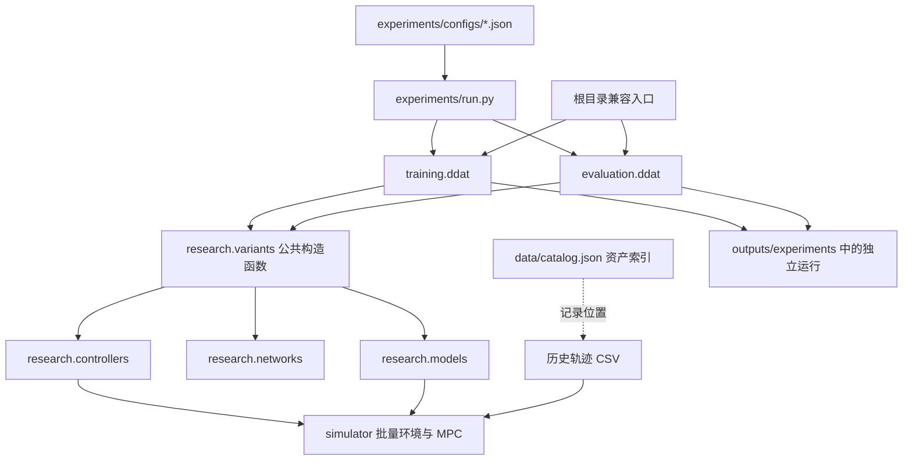

# 架构与修改边界

项目按训练、评估、实验组合和物理仿真划分。此次整理保持默认 DDAT 控制、网络、训练流程和历史数据路径，新增组件选择入口，便于用独立配置对照研究变体。

## 调用关系



`data/catalog.json` 是查找与审查入口；加载器仍读取配置中的真实路径，不会把目录中的数据 ID 自动转换为路径。

## 模块职责

| 修改目标 | 位置 | 边界 |
| --- | --- | --- |
| 训练编排、采样与 checkpoint | `training/ddat.py` | 通过公共工厂创建研究组件 |
| PPO 更新与优势估计 | `training/ppo.py` | 共享 `advantages`、`ppo_update`，算法保持原行为 |
| 配对评估、图表 | `evaluation/ddat.py` | 从 checkpoint 恢复组件配置，固定对照条件 |
| 逐路径指标汇总 | `evaluation/metrics.py` | 共享 `summarize_paths` |
| 路径选择与可行性筛选 | `trajectories/selection.py` | 共享 `select_paths` |
| 实验配置、进程和日志归档 | `experiments/run.py` | 给每次运行分配独立目录 |
| 观测预览、奖励与控制环境变体 | `research/controllers/` | 导出 `ExperimentDDATPathEnv` |
| 策略/价值网络变体 | `research/networks/` | 导出 `ActorCritic` |
| 动力学变体 | `research/models/` | 导出 `DynamicsModel`，保持现有状态及控制语义 |
| 配置到组件的映射 | `research/variants.py` | `create_environment`、`create_network` 共用构造逻辑 |
| 物理参数与路径读取 | `simulator/model.py` | 物理单位、`LoopPath` 与基础模型 |
| 批量模型及线性 MPC | `simulator/batch_mpc.py` | `BatchedUUVModel`、ADMM/OSQP |
| 批量任务与低层控制 | `simulator/batch_path_env.py`、`simulator/ddat_env.py` | 执行器、海流、扰动估计、任务终止 |
| RTI 求解与符号动力学 | `simulator/rti_mpc.py`、`simulator/rti_symbolic.py`、`simulator/rti_cuda.py` | CPU/GPU 后端及固定模型的符号表达式 |
| 执行器预报与恢复 | `simulator/fsp_predictor.py`、`simulator/ddat_recovery.py` | 预报、故障回放和恢复训练支持 |

研究变体先放入 `research/` 的对应子目录，保留默认模块作为可比较的基线。修改多个方案共用的物理数值方法时，再修改 `simulator/`，并验证对历史对照的影响。当前训练算法仍是 PPO；组件模块选择不代表实现了任意训练算法插件。

## 公共组件接口

配置中的 `controller_module`、`network_module`、`model_module` 是可导入的 `research.*` 模块名。默认值分别为 `research.controllers.ddat`、`research.networks.ddat`、`research.models.uuv`。默认模型导出原 `BatchedUUVModel`，不会更换原有物理参数。

```python
from research.variants import create_environment, create_network

env = create_environment(config, path_bank, batch_size=8, device="cpu")
agent = create_network(config, env.observation_size, device="cpu")
```

`config` 是训练配置字典；实验 JSON 中对应的是 `arguments` 对象。控制器和网络自定义参数分别使用 `controller_kwargs`、`network_kwargs` 字典。训练与验证使用相同工厂和 checkpoint 中记录的配置，避免两处构造参数随修改而分歧。环境的 `seed`、`horizon`、`randomize_plant` 等受管理参数使用普通配置键；`controller_kwargs` 与这些参数重名会报错。

模型插件目前限定为 10 状态、3 物理控制量的 UUV：状态为 `[north, east, depth, pitch, yaw, u, v, w, q, r]`，控制为 `[thrust, elevator, rudder]`。ADMM/OSQP 的预测和仿真环境使用所选模型；低层逆动力学也要求兼容现有模型属性。改变维度、姿态定义或执行器语义需要同步修改环境与求解器。

RTI 的离散动力学和雅可比来自固定的 `simulator/rti_symbolic.py`。环境明确拒绝自定义 `model_factory` 配合 RTI 后端；自定义动力学实验应使用 `admm`/`osqp`，需要 RTI 时另行实现并验证一致的符号动力学。路径可行性筛选仍使用原标称模型，不会根据模型插件自动更新。

## checkpoint 与复现

根目录 `DDAT_train.py`、`validate_ddat.py` 保留命令和导入兼容入口。训练配置随 checkpoint 保存；缺少组件选择字段的历史 checkpoint 使用默认模块。旧网络支持其既有观测宽度，但新变体改变观测布局或网络形状后必须使用匹配的 checkpoint。

`high_speed_experiments/`、`aav_mpc/` 是已有专题研究路线，尚未统一改写为 DDAT 的插件协议。使用其脚本时查看对应 README 和已冻结任务定义，不能假设它们自动继承新组件配置。
