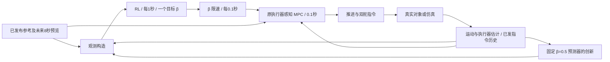

# GS-22：基于频域证据的 UUV 高速控制 RL 模块设计

日期：2026-11-13。交付类型：**设计文档，未实现新策略、未新增闭环仿真或训练**。本设计以 GS-21 已保存的阶段 A 和轻量 B–D 结果为依据；相关数据节选随本文收录于 [evidence](evidence/README.md)，本轮核对范围见 [VALIDATION](VALIDATION.md)。本文中的采样周期、特征尺度、奖励系数和训练预算，除明确注明沿用旧协议者，均为待验证的设计值。

**建议采用“频率与模型偏差感知的残差 β 调度器”：RL 每秒给出一个双舵预测参数目标，原 MPC 每 0.1 秒计算推进、升降舵和方向舵指令。观测同时包含当前运动状态、执行器及指令历史、密集参考预览、参考和误差的频率特征、固定模型的预测创新；动作保持一维，以 β=0.5 为初始中心，允许策略保持固定参数。**

采用这一结构的理由是：现有证据支持适中的固定 β，但旧频段规则没有超过它。新模块要检验的是“能否根据对象表现与过渡状态，决定何时值得偏离固定 β”，不能将已知的局部频响取舍直接写成“高频必增大 β”的控制律。原轻量方案的 PPO 启动门槛未通过，本设计不改变该历史结论；后续训练须先通过新的、明确标记为探索性的机会检查。

## 1. 已有证据对设计的约束

### 1.1 哪些结论成立

统一误差方向为 `e = reference − output`。历史综合评分记为

$
J_{\mathrm{track}}=\frac1T\int_0^T\left[(e_E/8)^2+(e_D/5)^2+(e_{V_N}/2)^2\right]dt.
$

它对应旧报告的 `R²`，越小越好，不是回归决定系数。下表的改善比例均指这一平方误差评分，不能解释为所有物理 RMSE 同比例改善。

| 已保存结果 | 能支持什么 | 对 RL 设计的要求 |
| --- | --- | --- |
| 15 m/s 组合失配对象：β=1 相对 β=0，最高已测频点 2.356 rad/s 的最大奇异值由 0.121988 降至 0.104493，约低 14.3%；前六点均更大 | 局部误差频响存在频率取舍 | 使用频率信息；不能宣称全部高频均改善，也不能从两端点线性推断中间 β 的闭环频响 |
| 匹配对象同一最高频点为 0.074379→0.198229 | 相同频率下保守端点可能更差 | 仅靠参考频率不足，需观察对象与模型的偏差 |
| 轻量 B 的 16 条开发任务：first 的 β=0/0.5/1 平均评分为 7.743e−8 / 6.168e−8 / 1.563e−7 | β=0.5 是这组离散候选的总体折中 | 初始策略及必备基线为 β=0.5；还须比较相同新协议下的最佳固定 β |
| 组合失配、first、深度：低频 0.785 rad/s 的 RMSE 为 0.085/0.311/0.621 mm，高频 2.356 rad/s 为 2.383/0.951/2.022 mm，依次对应 β=0/0.5/1 | 适中的 β 可优于完全保守端点；收益依赖频率和方向 | 动作连续且包含中间值，保持不同轴的频率特征 |
| C 的四条 12/18 m/s 高频深度/耦合路径：first 固定 β=0.5 相对 β=0 的平均评分低 78.73% | 少量开发性联合迁移检查有收益 | 航速纳入观测；这不是策略留出测试或全航速证明 |
| D 的每种结构均为 0 胜、2 平、2 负；first 规则平均评分高 25.46% | 旧规则未证明有调度收益；东向两条因动作相同而打平 | 保留“不调度”选项；奖励包含启动、切换及其后续误差 |
| D 的 first 深度低—高—低：低频段 RMSE 0.330→0.094 mm，高频段 1.017→1.232 mm，过渡窗口 0.740→1.458 mm，全程 0.641→0.766 mm | 局部稳态收益可能被后续动态和过渡代价抵消 | 输入相位、运动状态、执行器记忆及预览，不能只输入低/高频标签 |

数据来源：[七频奇异值](evidence/A_frequency.csv)、[逐任务三档 β](evidence/B_per_task_beta.csv)、[C/D 配对](evidence/C_D_pairs.csv)、[D 分窗指标](evidence/D_window_scores.csv)。260 条正式记录中有提前终止样本，不能称为 260 条全部成功；轻量 B–D 的 128 条记录全部完成且未记录 QP 失败或饱和。新方案不以这些有限结果主张闭环稳定性。

### 1.2 从频响到策略，哪些推断不能跳过

令 `z = [E/8, D/5, V_N/2]`，稳态小扰动下的误差频响满足

$
\tilde e(\omega)=H_e(j\omega;\beta,\mathcal P)\tilde r(\omega),\qquad
\|\tilde e\|_2\leq\sigma_{\max}(H_e)\|\tilde r\|_2.
$

`𝒫` 表示真实对象条件。σmax 是某一归一化参考组合方向的最坏增益；给定路径的误差还取决于实际输入方向、幅值、相位及通道耦合。单频稳态关系可用于提出假设，不能替代带启动和切换的闭环轨迹评价。改变 β 后系统随时间变化，冻结 β 的频响也不包含参数切换瞬态。

因此不把 σmax、离线最坏方向或真实失配标签作为在线观测。保留 E、D、VN 的独立复数频率系数，让策略区分方向、相位和混合激励；训练目标仍是实际路径误差。七频矩阵只用于离线复核最终策略的局部代价，不作为每秒可获取的“在线 FRF”。

## 2. 控制架构与模块边界

首版使用 GS-21 的 `first` 原 22 状态预测结构，保持 MPC 35 步时域（3.5 秒）、原权重及约束、0.02 秒对象积分。β 只改变双舵预测参数：

$
g_{\mathrm{fin}}^{\mathrm{pred}}=1-0.15\beta,\qquad
\tau_{\mathrm{fin}}^{\mathrm{pred}}=(1+\beta)\tau_{\mathrm{fin},0}.
$

真实对象参数保持独立。原适配接口对应 `solve(..., alpha=[beta, 0.], theta_hat=[0.85, 2.])`；第二个 alpha 固定为零，不开启残差力补偿。该接口依据见 [旧循环快照](evidence/closed_loop.py.txt)。

先选 first 是为了只检验 β 调度的增量价值，避免将预测结构收益与策略收益混合。混合结构对组合失配的推进通道曾有明显局部收益，但在轻量双舵任务上没有证明它使 β 调度更好；它应作为后续独立结构对照。若纯速度任务误差主要来自推进阶次，双舵 β 几乎没有控制权限，不能要求本模块修复；若这成为主要瓶颈，再单独研究推进模型选择。

**每个新协议回合均从实际 β=目标 β=0.5 开始**，前 8 秒固定该值以建立历史窗，计分包含这 8 秒；所有新比较方法使用相同初态和限制。旧 B–D 从 β=1 开始，不能把新实验与旧绝对评分直接相减。

## 3. 状态空间：环境状态与策略观测分开定义

### 3.1 为什么不能只用误差，或直接照搬 22 状态

环境的完整状态包括运动状态、真实执行器内部状态和延迟、MPC 的计划/上次命令、当前及目标 β、观测历史、参考生成器状态。仿真可访问其中部分隐藏变量，实际策略不应获取真实舵效、时间常数、二阶执行器真实速率、对象类型、任务编号、频率阶段标签或未来实测输出。

22 状态是 MPC 的预测状态维数，不是 RL 观测必须等于 22 的理由。瞬时物理状态缺少任务预览和未知失配信息；只给跟踪误差又会将不同航速、舵状态和延迟历史混为一谈。首版采用下面的 **78 维因果观测**。这是对部分可观测过程的有限历史近似，不宣称严格满足 Markov 性；MPC 暖启动计划和未知对象仍会留下隐藏信息。若确有证据表明历史不足，再做有记忆网络消融。

### 3.2 首版 78 维观测契约

设导航系 N/E/D 向量与旧输出约定一致，体轴状态为 `u,v,w,q,r`，姿态为 `θ,ψ`。角度误差用 `atan2(sin Δ,cos Δ)`。下表按顺序拼接，区间为 Python 的左闭右开索引。

| 区间 | 维数 | 观测与尺度 | 选取理由及获取方式 |
| --- | ---: | --- | --- |
| `[0:10]` | 10 | `eN/8,eE/8,eD/5,eθ/(π/18),eψ/(π/18),(u−15)/3,v/1,w/1,q/0.2,r/0.2` | 误差给出任务偏离，航速影响约为速度平方的舵力，侧向运动和角速度区分“尚未转动”与“正在过冲”；来自导航/姿态估计。上述尺度均对应各物理量的单位，不是状态界限 |
| `[10:17]` | 7 | `sin θr,cos θr,sin ψr,cos ψr,VNr/18,VEr/1,VDr/1` | 与姿态误差及体轴速度共同描述当前参考方向和速率；三角编码避免参考航向跨 ±π 的跳变 |
| `[17:32]` | 15 | 实际执行器估计 `η/S` 三维；最近三个 0.02 秒已发命令槽 `Q/S` 九维；因果速率估计 `τ0·dηhat/dt/S` 三维 | 同一船体状态下，执行器滞后和已发命令会改变下一步响应。`S` 沿用 CONTROL_SCALE，`τ0` 为三个名义时间常数；用已发命令重建控制器侧历史，不读取真实对象未知的延迟队列 |
| `[32:34]` | 2 | 当前实际 β、上次目标 β | 限速使目标不等于实际值；二者差值表示参数还需多久才能到位 |
| `[34:43]` | 9 | `r_z(t+δ)−r_z(t)`，δ=0.5/1/2 秒，逐偏移、逐 E/D/VN 拼接；分别除以 0.048 m、0.030 m、0.012 m/s | 近未来位移和速度变化保留切换时序；补充长窗频率系数对局部过渡形状的压缩损失 |
| `[43:67]` | 24 | 参考预览窗与误差历史窗各 12 维：3 轴×2 频率锚点×实/虚部 | 分辨低/高频、空间方向与相位；只从参考和已观测误差计算，具体定义见下节 |
| `[67:73]` | 6 | 固定预测器对 `[u,q,r]` 的一步创新，过去 8 秒的有符号均值三维及 RMS 三维；分别除以 0.01 m/s、0.001 rad/s、0.001 rad/s | 让策略看到“对象如何偏离共同基准模型”，以区别同频不同失配；固定预测器避免策略仅因改变自身 β 就改变创新基准 |
| `[73:78]` | 5 | 最近已发命令的归一化边界余量三维、上次 QP 成功标志一维、有效误差历史时长/8 秒一维 | 接近指令边界时，线性频响推断更不可靠；历史填充标志避免将刚启动的零特征理解为已确认无误差 |
| **总计** | **78** | **10+7+15+2+9+24+6+5** | Actor 与 Critic 使用同一观测，无真实对象特权输入 |

补充约定：推进指令区间 `[0,1]`、双舵 `[-1,1]` 时，边界余量定义为 `2·min(c−l,u−c)/(u−l)`，恰在边界为零、中心为一。速率只用最近执行器反馈的后向差分和一阶因果平滑，平滑时间常数初设 0.2 秒；仿真中也不直接使用 `Plant.rate`。创新是在上一周期用共同 β=0.5 的模型、当时的估计状态与实际已发命令预测 0.1 秒，再用本周期的估计 `[u,q,r]` 相减。初版创新预测器仍是一阶模型，不能据此宣称识别出了真实阶次。

运动、执行器和创新等有量纲特征先按表中固定尺度变换，再截断到 `[-10,10]`，余量与标志保持其定义范围。尺度不从测试数据估计。它们适用于当前小扰动任务；噪声下创新可辨识性及饱和比例要另外记录。舵没有获得足够激励时，创新很小并不能证明模型匹配；前 8 秒保持固定基线，无舵激励的纯速度样本不用于判断舵参数辨识是否成功，也不通过隐藏任务标签强制动作。

### 3.3 频率特征的可计算定义

首版仅使用已完成轻量对照的两个锚点

$
\omega_L=2\pi/8=0.785398\ \mathrm{rad/s},\qquad
\omega_H=3\cdot2\pi/8=2.356194\ \mathrm{rad/s}.
$

二者分别是 0.125 Hz 和 0.375 Hz。“L/H”是这两个实验锚点的简称，不是从七个频点中识别出的全频带分界。尤其 0.196 rad/s 的周期为 32 秒，8 秒窗不足以声称可靠辨识它；新任务含该频率或宽带海流时，必须重新检查表示覆盖。

参考窗口为 `t+[0,0.1,…,7.9]`，历史误差窗口为 `t−7.9+[0,0.1,…,7.9]`；都是 80 点，避免重复端点。每个轴的信号先按 `z=[E/8,D/5,VN/2]` 归一化。对两种窗口各轴，用固定设计矩阵进行最小二乘：

$
s(\tau_i)\simeq b_0+b_1\tau_i+
c_L\cos(\omega_L\tau_i)+d_L\sin(\omega_L\tau_i)+
c_H\cos(\omega_H\tau_i)+d_H\sin(\omega_H\tau_i).
$

`b0,b1` 仅用于去除偏置和线性趋势，不送入频率块；当前误差已在前面的观测中保留。令 `C_b=c_b−j d_b`。预览窗的局部时间从 t 起算；历史窗的局部时间从 t−7.9 起算，故历史系数再乘 `exp(jω_b·7.9)`，使两种系数的相位均参考当前时刻 t。输出顺序为：先参考、后误差；每种按 E/D/VN、L/H、Re/Im 排列。

参考系数统一除以 0.006（旧轻量输入的归一化幅值）；误差系数按三个归一化轴尺度 `[(0.001/8),(0.001/5),(0.0001/2)]` 缩放，分别对应 1 mm、1 mm、0.1 mm/s。再按上一节规则截断。历史不足 80 点时误差频率块置零、有效历史比例如实给出，前 8 秒使用固定动作。

这是一组可预计算伪逆的 **有限窗投影特征**，不是在线系统辨识或精确时变频谱。切换、包络和窗外频率会造成投影混合；相位及近时预览用于保留补充信息。固定 80×6 矩阵的运算量很小，无需每秒辨识完整 3×3 FRF。

旧观测只给未来 4/8 秒的三个参考差值，存在明确的非唯一性。例如在同幅值同当前相位的稳态正弦下，`ωL·4=π`、`ωH·4=3π`，`ωL·8=2π`、`ωH·8=6π`，两个频率在这两处的参考值完全相同。这不证明旧 19 维观测整体一定无法区分两工况，但证明这六个预览分量本身不足以可靠编码频率。密集预览和双锚点投影解决这一具体信息缺口。

未来参考仅来自已发布、在线可获得的任务计划，**不能**从未来实测输出、测试轨迹实际误差或仿真对象参数生成。若实际系统只提供 MPC 的 3.5 秒预览，当前 8 秒版策略不满足输入契约；应以实际预览长度重新训练和比较，不能沿用同一策略权重。

## 4. 动作空间：一维连续目标 β

### 4.1 数学定义和时间尺度

策略采样潜变量 `v_n ~ Normal(μθ(o_n),σθ)`，动作是

$
a_n=\tanh(v_n)\in(-1,1),\qquad
\beta_n^\star=0.5+0.5a_n\in(0,1).
$

因此这是围绕固定 β=0.5 的有界残差动作；v=0 时精确对应基线。离散固定对照仍可直接取闭区间端点 0/1。执行时使用潜变量均值的 tanh，取消采样。每秒决策一次、目标保持 10 个 MPC 周期；每个周期更新

$
\beta_{k+1}=\beta_k+\operatorname{clip}(\beta_n^\star-\beta_k,-0.02,0.02).
$

沿用旧协议的 β 限速：最大 0.2/s，0↔0.5 至少需要 2.5 秒，0↔1 至少需要 5 秒。1 秒动作周期给策略多次修正过渡的机会；它并不要求 β 按 0.375 Hz 跟随每个参考波峰。旧 8 秒周期并非因为低于载波 Nyquist 频率就“必错”，问题是相对 2.5 秒参数过渡只有粗粒度时序控制，且预览存在上述非唯一性。

### 4.2 为什么这样选

| 候选动作 | 首版取舍 | 依据 |
| --- | --- | --- |
| 直接输出推进/双舵或加控制残差 | 不采用 | 绕开当前 MPC 对执行器与约束的处理；现有证据主要关于预测参数，不足以支持新的直接控制权限 |
| 一个共享双舵 β 目标 | **采用** | 与已验证的参数插值完全一致；连续值能检验 β=0.5 附近的折中；动作维度小，固定基线在动作空间内部 |
| 每秒输出 Δβ 并累加 | 不采用 | 容易产生累积漂移；绝对目标加显式限速更易解释，实际 β 和目标的差异可观测 |
| 两个独立 β，分别调升降舵与方向舵 | 暂缓 | 方向偏好不同给出了研究动机，但旧数据只沿共同 β 一条线取样，尚未检验双舵分离后的耦合收益；先用耦合任务确认一维动作的上限 |
| 同时调舵效和时间常数，或再调 MPC 权重/结构/参考速度 | 暂缓 | 扩大到尚无对应配对数据的参数面，收益归因和采样成本均增加；先证明现有一维权限有增量价值 |

共享 β 可能在同时水平/深度机动时出现表达能力瓶颈。若新机会检查显示单轴分别有收益、耦合时互相抵消，再做两 β 的小规模静态 3×3 对照，之后才决定是否扩维；不能只为“更灵活”就提前增加权限。

β 的区间、限速和 MPC 约束限制了策略权限，但并不构成参数时变闭环的稳定性保证。任何 QP 失败、非有限状态或沿用诊断界限越界均按失败回合记录并停止该回合；回到基线只能从重新初始化后的下一回合开始，不能声称现场切回 β=0.5 就一定恢复可行。

## 5. 学习目标、奖励及算法

### 5.1 用全程代价学习切换取舍

采用与历史评分对齐的三个主跟踪量。每个 0.02 秒子步计算设计阶段代价

$
\ell(t)=\min\left\{10^6\|\bar e(t)\|^2
+10^{-3}\left(\frac{\dot\beta}{0.2}\right)^2
+10^{-3}\frac{1}{3}\sum_{j=1}^3
\left(\frac{\Delta c_j}{\Delta c_{j,\max}}\right)^2,\ 100\right\},
\quad \bar e=[e_E/8,e_D/5,e_{V_N}/2].
$

`c=command/S`，Δc 是每 0.1 秒已发命令增量，Δcmax 沿用原 MPC 的增量约束；该值在对应五个子步上保持。所有新基线也使用相同执行接口。β 和指令变化惩罚系数初设均为 1e−3，作用是使同等精度下的平稳策略更有利，不预设调节本身不值得。未加 `|β−0.5|` 惩罚，避免直接把策略压回基线；也不单独奖励某个频段，避免为低频奖励牺牲过渡。

每个 RL 间隔的奖励为 `r_n=−(1/T)·∫interval ℓ(t)dt`，其中 T 是任务**预定**总时长，含启动及所有过渡。取 γ=1 的有限回合目标，避免低估一次调节在几秒之后的代价；GAE 的 λ 初设 0.95。正常到达预定终点时终端价值为零。

若在 t_f 提前失败，增加 `−100·(T−t_f)/T−10` 并终止。因阶段代价有 100 的上界，补齐剩余时长的最坏代价再罚 10，可避免在相同失败前缀下通过提前终止逃避未来成本。训练中的截断只为限定回报尺度；**评价使用未经截断的 Jtrack、全部物理 RMSE、失败数和饱和率**，不能用裁剪后的回报声称物理性能改善。

诊断界限沿用旧协议的横向位置 8 m、深度误差 5 m、沿参考速度误差 2 m/s、俯仰 40°；它们是回合终止条件，不是实艇安全认证。其他输出如 N、姿态和侧向速度虽不进入主评分，仍需报告；主评分降低而这些量明显恶化时不能接受新策略。

### 5.2 首选小型 PPO，但不把它当作收益来源

用 78→64→64 的 tanh MLP、一个标量 Actor 和一个标量 Critic 即可；Actor 最后一层初始化为零，使初始均值动作是 β=0.5；初始潜变量标准差设 0.15。使用 PPO 的裁剪目标、学习率 3e−4、clip=0.2、每批 8 回合、4 个更新 epoch；参数均需写入新协议。保留“始终 β=0.5”开发检查点，若学习后的策略更差，最终应选择并如实标记常数策略。

选择 PPO 是为了复用已有小型连续策略框架。PPO 原论文支持其采样—更新的算法结构，并不证明它在本 UUV 任务上更有效或省样本。[Schulman 等，2017，v2](https://arxiv.org/abs/1707.06347v2)；通过 RL 调 MPC 参数也有方法先例，但该理论文献不替代本设计的闭环验证。[Gros 与 Zanon，2019 预印本 / 2020 期刊论文](https://arxiv.org/abs/1904.04152v1)

PPO 保存采样潜变量 v 及其旧 log-prob，更新时在同一潜变量上计算概率比；不要把 β 当作高斯变量。若使用动作域 log-prob，则需包含 tanh 及线性映射的 Jacobian；两种实现选一种并固定。评分、数据划分、失败规则和动作映射全部进 checkpoint 元数据。观测维度与语义已改变，旧 19 维网络权重不能直接复用。

## 6. 轻量验证路线与继续/停止条件

**本节是后续实验建议，不是本轮已经执行的实验，也不是重启旧 E/F。** 先验证这组动作和时序是否有机会，再训练；首轮上限 100 条 144 秒闭环轨迹，单结构、单训练种子，仅用于可行性探索。

| 阶段 | 固定内容与规模 | 目的和停止条件 |
| --- | --- | --- |
| S0：机会检查，20 条 | 4 条开发路径＝组合失配×深度/耦合×两种频率顺序；每条比较固定 β=0/0.5/1，以及两条诊断性平滑调度（见下文） | 最佳调度相对同组最佳固定 β 的四任务平均 Jtrack 至少低 5%，且至少 3/4 配对改善、均完整且无 QP 失败或饱和，才进入 S1；否则停止于固定参数方案，保留设计供后续使用 |
| S1：PPO 可行性，32 条 | 从预先冻结的 16 条训练参考均匀抽样；对象 matched/combined，方向 depth/coupled，顺序两种，相位两种；单种子 41001 | 32 回合不是收敛或可靠性保证。每 8 回合形成一个检查点，含初始常数检查点 |
| S2：开发选择，16 条 | S0 的同四条开发参考；仅评四个训练检查点，固定基线与诊断规则结果复用 S0 | 按完整性优先、再按平均 Jtrack 选一次检查点；开发集不作为泛化证据 |
| S3：冻结留出，32 条 | 预先冻结 8 条新任务，每条比较最佳固定 β、选定诊断规则、常数 β=0.5、选定 PPO，共 4 法 | 检查新增收益是否迁移；即便两个基线重复仍按最坏 32 条预算，允许缓存同协议的完全相同结果 |
| **上限** | **20+32+16+32=100 条** | **S0 不过则只执行 20 条，无 PPO；不启动全 β 大网格或多结构多种子训练** |

S0 两条诊断规则仅用已知参考计划：深度/耦合的目标设为 `0.5·h(t+L)`，`h` 是参考生成器中高频分量的平滑混合权重，`L=0 或 2.5 秒`；同样每秒更新并受 β 限速。它们使用了路径分解先验，作为机会探针和强规则基线，不是未知路径上可直接部署的规则，也不是动态最优上界。S0 若通过，只支持“该权限存在值得学习的时序”，不证明 78 维观测一定足以实现它。它们与旧 D 的 8 秒规则不同，结果不能改写为旧协议已通过。

任务冻结建议：S0/S2 相位固定为 0.93，航速 15 m/s、原幅值；S1 两相位为 0.17/1.73，航速 15 m/s、原幅值。S3 在运行 S0 前即登记：前四条为 15 m/s、半幅值、新相位 2.41，覆盖 matched/combined×深度/耦合，顺序按任务交替；后四条为 12/18 m/s、原幅值、新相位 2.41，combined×深度/耦合，顺序同样交替。耦合 E/D 相位差统一 π/2。不得用留出结果修改动作、尺度、奖励、规则提前量或检查点。此留出只是八个固定场景的联合迁移检查，不能解耦航速/相位/幅值的单独效应。

固定 β 在 S0 上从 0/0.5/1 三档按任务等权平均选取，不能用留出选参。S2 若只选择到初始常数策略，应报告“未获得 RL 增量收益”，无需把同一常数重复评为新策略。若 S0 失败，S1–S3 停止；若 S1/S2 未改善，报告开发性阴性结果并停止，不反复更换训练种子直到获胜。

该 100 条上限约对应 144,000 次 MPC/QP 求解；按每条 30–120 秒估算，纯闭环约 50–200 分钟，实际先测本机单条耗时。增加神经网络训练不会消除 MPC 成本；这些是估算值，不是平台硬性时限。完整训练仅一个种子，不能给出训练稳定性结论；只有先导留出出现增量收益后，才值得安排多种子确认和“去频率特征/去创新/8秒动作”三个独立消融，不将其暗中计入本轮轻量预算。

## 7. 评价与实现交接

最终比较按同一路径、对象、初态、β 初始值、参考与失败规则逐任务配对。先报告完成/失败、QP 失败、饱和和诊断越界；再对完整共同任务报告全程 Jtrack 与 E/D/VN 物理 RMSE，并给出 N/姿态/侧向速度、最大误差、β 总变差、指令变化率。提前失败记录保留已观测数据，不加入“成功任务平均 RMSE”冒充全体表现。

另外报告低频段、高频段、频率混合过渡段及**调参完成后恢复段**，不能仅固定截取 ±2 秒就假设切换效应已经结束。冻结策略后才可在与旧阶段 A 相同的小扰动桥接条件下检查三轴完整 FRF；策略有历史和时变动作，若不满足周期稳态，应报告非稳态频率诊断，而不是沿用固定线性 FRF 的解释。8 秒特征窗覆盖以外的频率不作泛化结论。

实施时可参考归档目录 `experiments/gs20_gs12_continuation/` 的职责划分；它目前存在于 GS-21 工作空间快照，**本仓库此次只随附关键接口文本，不包含可运行的续接实验包**：

| 接口位置 | 新版本需要实现的内容 |
| --- | --- |
| `Session.observe()` | 由 19 维升级为上述 78 维；密集参考预览、固定模型创新与环形历史缓冲；只使用控制器可得数据 |
| `Session.step()` / 配置 | 决策周期从 80 改为 10 个控制周期；限速保持 0.02/周期；新初态与 8 秒历史建立阶段 |
| `policy.py` | 78 维输入、中心化有界动作；旧权重不兼容；概率比记录潜变量 |
| `train.py` / 奖励 | 按每子步积分全程代价；处理剩余时长失败补偿；记录策略、协议和观测契约版本 |
| `metrics.py` / 结果 | 主评分与历史定义相同；追加恢复段、β 轨迹和执行器/指令指标；保留失败分母 |

最低功能验证应先确认：78 维索引及单位一致；相同 4/8 秒预览的两个频率能被新特征区分；历史窗无未来数据泄漏；固定目标0/0.5/1正确映射并达到限速；创新预测使用实际已发命令且只读取过去；所有方法初始化一致；失败不能靠短回合获得更好训练回报。然后才运行 S0。本轮仅完成文档与离线数据/公式核对，不应将这一清单写成“RL 实现已通过测试”。

## 8. 方案成立的边界

本设计的可检验假设是：**在已有固定参数折中的基础上，频率、对象响应偏差与过渡记忆联合输入，可能使一维 β 调度获得额外收益。** 当前数据已支持前半句的固定参数折中，尚未支持后半句的 RL 增量收益。若机会检查仍未通过，保持固定 β=0.5 或开发集选出的固定值，就是合理的实验结论。

RL–MPC 参数调节的文献先例仅支持方法路线；这里的观测、奖励、1 秒周期及 8 秒窗是本项目提出的工程假设。噪声、海流、未测频段、大幅机动、真实传感器可用性、实时计算与切换稳定性均未由现有轻量实验验证，不能在文档中提升为已证能力。
