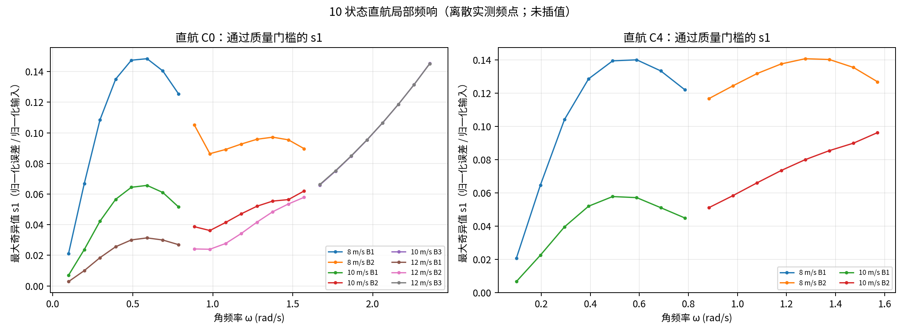
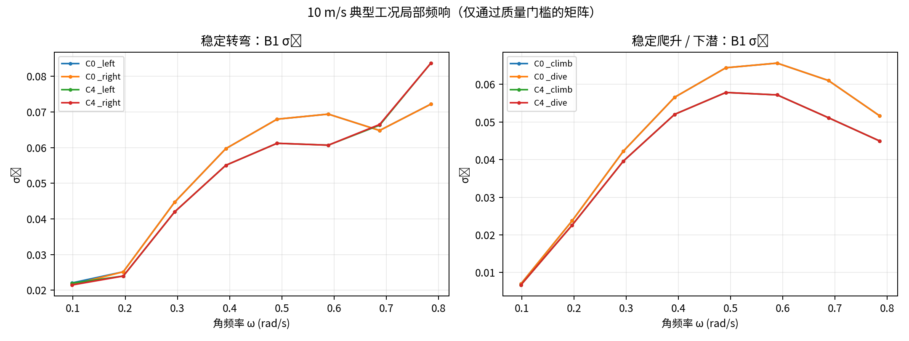
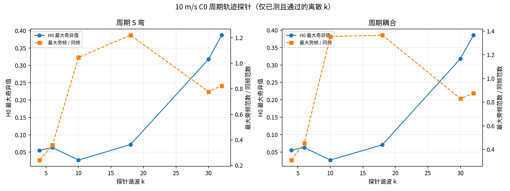
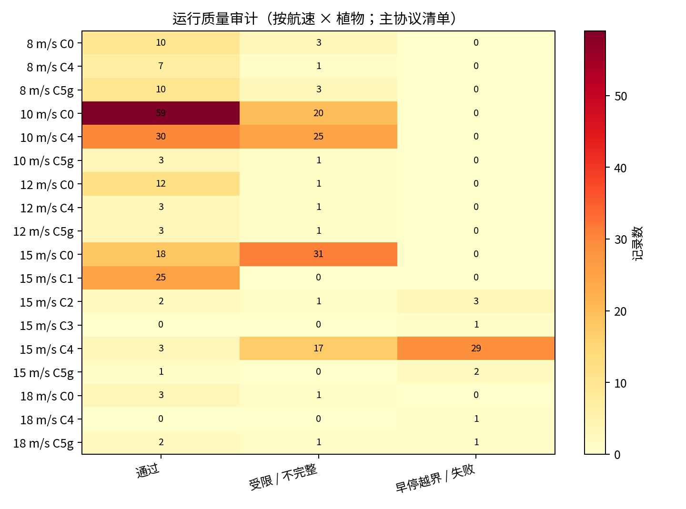
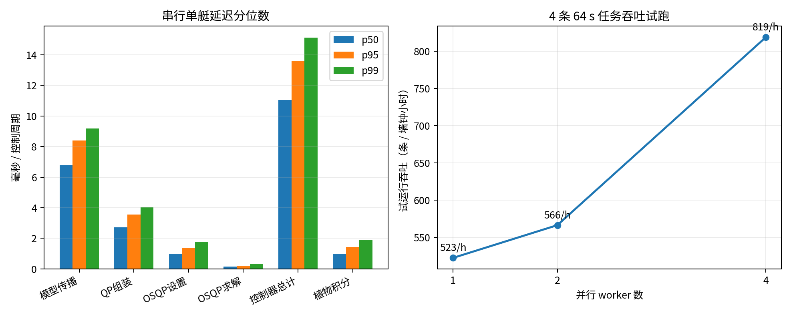
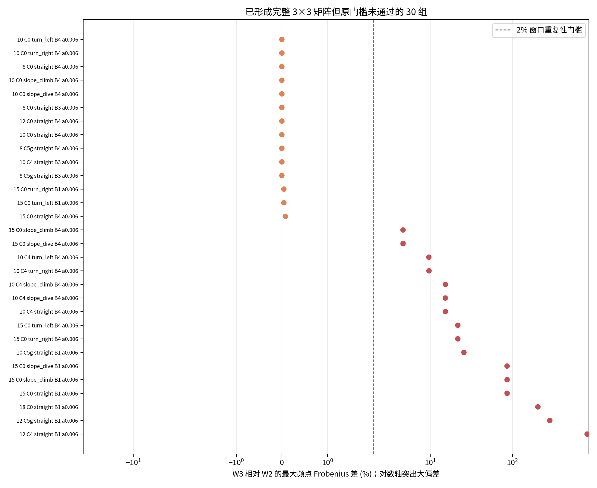
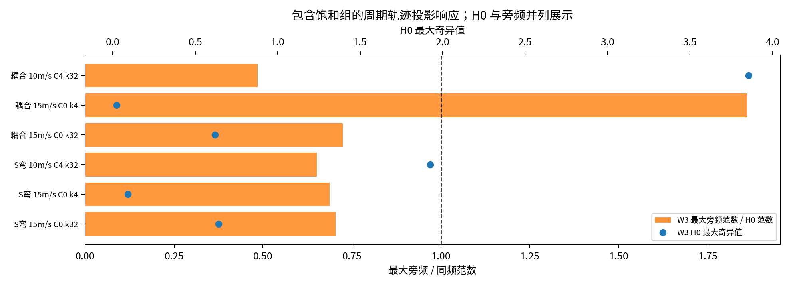
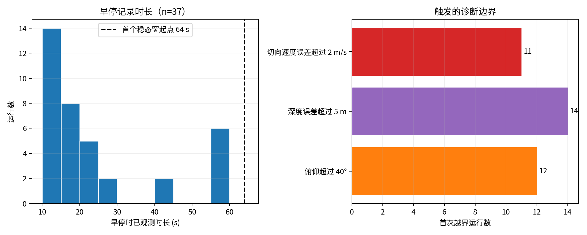

# GS-12 10 状态局部频响与典型工况实验报告

## 范围与结论

实验按方案中的预检与运行规则执行。10 状态主实验当前协议 `54b768131bb1139d…` 下汇总 **335 条主测量记录**，包括早停和受限记录；另有 **12 条资源试跑**，当前协议共 **347 条记录**。另有 **7 条理想即时执行器诊断记录**。这两部分共 **354 条 10 状态轨迹**完成 SHA-256 核查，错误 **0 条**。产生 **74 个矩阵组**，其中 **44 个满足原方案严格判据**（周期工况使用其专用质量字段）；这只是对重复性/线性范围的标签，不是纳入本报告分析的条件。其他受限、漂移或缺项结果也纳入补充分析，原始记录均保留。

实验执行沿用了方案中预检和触限后停止后续频带的运行规则，因此部分预定频点没有采集；这影响覆盖范围，不代表已采集的受限数据没有分析价值。报告同时给出严格判据子集、受限完整窗响应和早停瞬态诊断。每个窗的数据充分性、频谱估计条件、饱和、触限、窗口漂移分别标注；不把受限响应解释成未受限的小信号线性模型，也不因其受限而从结果中删除。

## 模型核验与实验设置

- 10 状态预测器雅可比有限差分最大绝对误差为 `4.56e-9`（门槛 `2e-5`）；解析参考导数最大误差为 `3.33e-9`（门槛 `2e-6`）。理想即时执行器下一步传播误差为 0。带真实延迟的 C0 下一步差为 `0.0321`，这是预期的执行器结构失配。
- 10 状态与真实植物共用艇体模型与 22 状态凝聚型 QP 目标／约束；10 状态控制器只读艇体状态。所有运行保存协议、源码、参考哈希和原始时序。主记录汇总的状态为：`complete_constrained` 110 条, `complete_valid` 197 条, `early_violation` 40 条。
- 已完成 C1、15 m/s、直航、`a=0.006` 的半幅复测；该条件 B1–B4 在 `a=0.003` 和 `0.006` 下均通过。按频带计算的最大 W3/W2 相对变化不超过约 `0.075%`；最大半幅差不超过 `1.63%`，均低于方案的 2% / 5% 门槛。

## 频响结果

按原方案严格判据，C1、15 m/s 是唯一完整满足全部 B1–B4 的直航条件；图中该子集用于呈现较稳定、近似线性的结果。其余已采集的完整矩阵也有 W1/W2/W3 估计，并在补充分析中展示，包括饱和和触限工况；触限后停止后续频带造成的缺项另行标记。

稳定转弯与坡度中，10 m/s、C0/C4、B1 的左右转弯和爬升／下潜组满足原方案严格判据；B4 和 15 m/s 的已采集响应按受限/完整状态分别标注。B1 之外未作连续曲线推断。

周期 S 弯与耦合轨迹的有效探针矩阵来自 10 m/s C0，已测 `k=4,6,10,18,30,32` 中通过门槛的组按原始分析记录绘图；其中 `k=4/32` 是预注册预检点，其余为完整频率探针。C4 只在 `k=4` 预检通过，`k=32` 受限后停止；不得把预检点当成完整频带。旁频是局部周期投影指标，不能解释为一般轨迹追踪成功率。

## 本次范围

本次交付聚焦 10 状态局部频响与典型工况。报告不纳入 22 状态比较。执行过程中曾启动 22 状态对照；收到范围澄清后已停止。140 条部分结果及其协议清单保留在 `paired22_campaign_v3/`，另有早期试跑和 13 条 C1/15 m/s 配对记录位于 `paired22_campaign/`、`paired22_campaign_v2/`、`paired22_exact/`；这些记录均不参与本报告结论。依赖 10/22 同工况配对的复方向重放也未纳入本次 10 状态范围。

## 数据标签、运行停止规则与计算代价

方案中的 2% 窗口差和 5% 半幅差用于判断重复性与近似线性范围；饱和用于识别执行器受限响应。它们是解释标签，不是“能否计算频响”的门槛。横向、深度、速度、俯仰边界是本轮仿真运行的停止规则：触限后没有继续跑后续频带，因而形成缺项；但触限前有效样本仍可用于瞬态或短窗频谱分析。所有早停都保留第一次触限时间和子步。完整 256 s 及 W1/W2/W3 是为方案内窗口对比而设，不是频响分析的普遍要求。

两次 64 s 串行试跑均值的控制器耗时为 p50 `11.03 ms`、p95 `13.61 ms`、p99 `15.12 ms`；植物积分 p99 `1.92 ms`。4 条任务试跑吞吐为 1/2/4 worker 分别 `523/566/819` 条每墙钟小时，4 worker 比 1 worker 提高约 `56.7%`，无 OOM；单艇延迟与并行吞吐分开测量。

## 未完成项与复现材料

- 15 m/s 新工况未完成预定半幅复测；这些频点仍可报告实测响应，但没有足够证据判断该幅值范围内的线性程度。
- 周期轨迹的 `input_normalized` 原始日志字段曾写成零；分析器根据运行元数据、幅值、启动包络和频率确定性重建探针输入，矩阵记录已显式标注 `input_reconstruction`。艇体实际参考输入未更改。
- 理想即时执行器诊断 7 条全部有效，B1/B4 矩阵通过。

复现入口和配置见本目录 `README.md`、`src/`、`analysis/`。关键文件：`protocol.json`、`controller_verification.json`、`manifest.json`、`scope_10state_integrity.json`、`summary.json`、`matrices/`、`quality_gate_audit.json`、`ideal_diagnostic/`。方案 SHA-256：`f1fde2cd57822c3da64f1a2e50f0c8c607ac69605aab726750094ec709fdceef`；主分析源码 SHA-256：`e9f46c8415a6b610ff36fb09ae7fe0158d758a091420fd81f45c099aecf899c9`。所有新实验产物均在 `experiments/gs12_10state_experiment/` 下。

## 未过滤数据的补充分析

这部分把受限矩阵也作为响应结果展示。30 个完整 3×3 矩阵虽未满足原方案严格判据，**全部在 W2 或 W3 有至少一个命令/执行器饱和通道**。其中 14 组的 W3/W2 最大相对差不超过 2%，另 16 组超过 2%。前者是重复的**受限闭环频响估计**，后者同时显示窗口漂移；饱和改变了系统的局部线性条件，但不妨碍报告实测频谱比值。是否称为“小信号线性 FRF”与是否分析响应是两件事。

例如，10 m/s C0 直航 B4 的 W3/W2 相对变化约 `6.86e-11`，绝对 Frobenius 差约 `6.66e-11`；同时 W2/W3 的横向激励轴和深度激励轴出现饱和。这说明重复性好并不自动代表线性响应。10 m/s C4 直航 B4 的相对变化为 `15.2%`，绝对差 `0.495`；12 m/s C4 直航 B1 则分别为 `811.9%` 和 `0.035`。相对差很大时同时给绝对差，避免在响应范数很小时误读百分比。

周期工况补算了完整饱和运行的 H0 同频投影和旁频。W3 有 20 个完整 3×3 周期探针组，其中 6 组包含饱和；15 m/s C0 耦合轨迹 `k=4` 的最大旁频范数达到 H0 范数的 `1.86` 倍。旁频与同频同量级或更大时，H0 只能看作周期轨迹上的同频投影，不能单独概括响应。

另对 **37 条早停运行**计算了首次触限、触限前归一化路径误差的峰值/RMS、输入峰值、QP 失败和饱和比例。早停时长为 `11.1–57.6 s`，中位数 `17.3 s`；没有一条达到方案固定 W1 窗的 64 秒起点。它们不能与 64 秒稳态窗作同口径比较，但仍可对较长记录做短窗谱/时频响应，对极短记录做瞬态响应和触限前输入输出分析。首次触限包括深度边界 14 次、俯仰边界 12 次、切向速度边界 11 次。当前报告给出触限前瞬态诊断；没有把不同窗长的截断谱误称为方案定义的稳态 FRF。

| 工况 | 植物 | 方向/轨迹 | 早停数 |
|---|---|---|---:|
| 耦合 | C4 | 周期基线 | 7 |
| S弯 | C4 | 周期基线 | 2 |
| 坡度 | C4 | 爬升 | 7 |
| 坡度 | C4 | 下潜 | 7 |
| 直航 | C2 | — | 3 |
| 直航 | C3 | — | 1 |
| 直航 | C4 | — | 3 |
| 直航 | C5g | — | 3 |
| 转弯 | C4 | 左转 | 2 |
| 转弯 | C4 | 右转 | 2 |

在 W3 可用数据中，有 80 个完整 3×3 窗口、11 个可计算部分方向列的窗口，另有 2 个组没有任何完整 64 秒窗；其中 47 个已有响应窗口至少一条参与运行有饱和。部分方向组只保存实际测得的矩阵列，没有补齐缺失列。完整逐频点复矩阵、旁频、状态和受限标记见 [`unfiltered_response_analysis.json`](analysis/unfiltered_response_analysis.json)；分组数据见 [`nonpass_full_direct_matrices.csv`](analysis/nonpass_full_direct_matrices.csv)、[`periodic_window_responses.csv`](analysis/periodic_window_responses.csv) 和 [`early_stop_diagnostics.csv`](analysis/early_stop_diagnostics.csv)。
