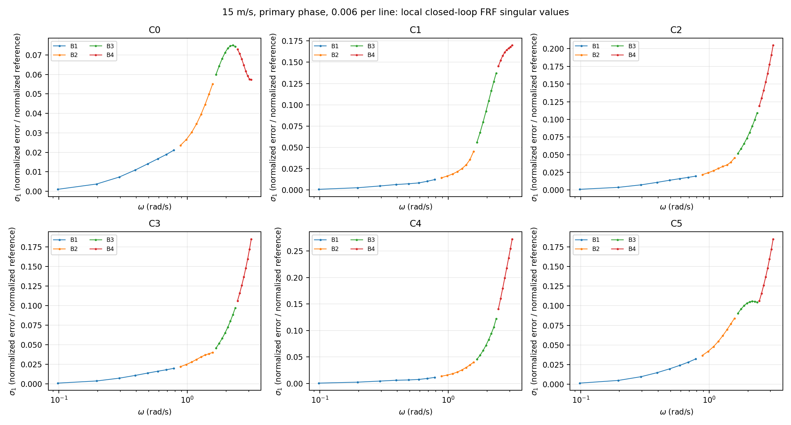
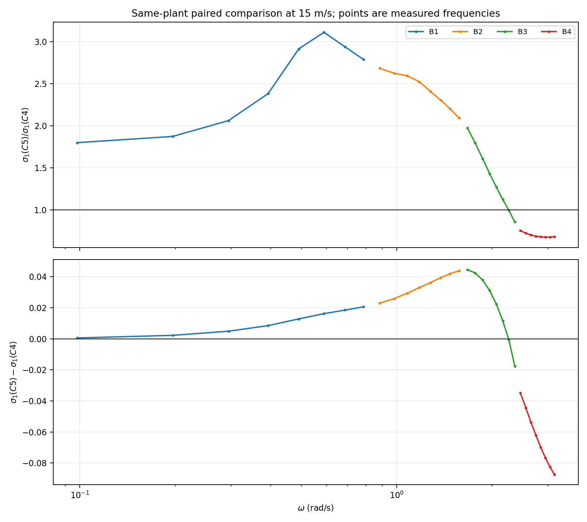
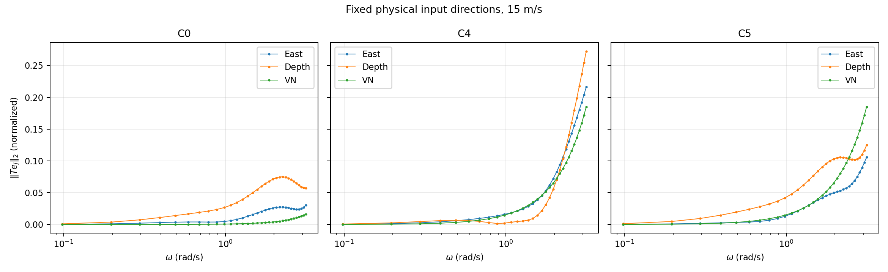
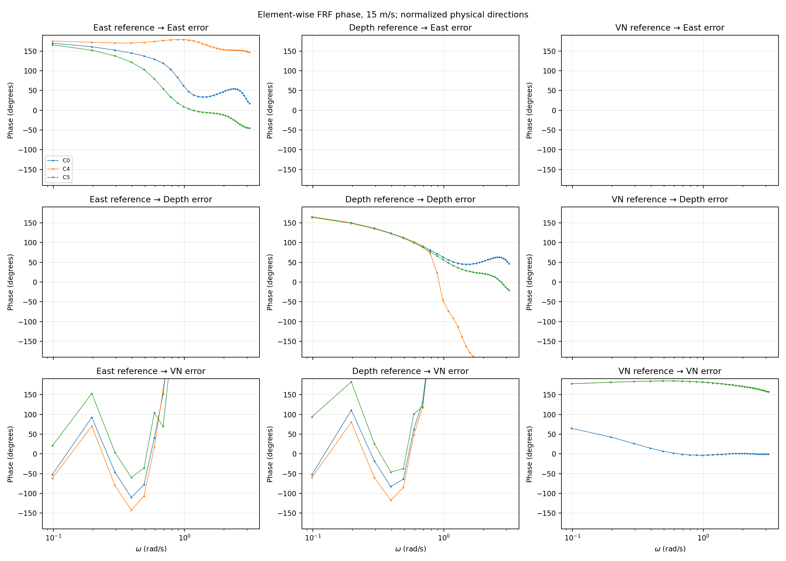
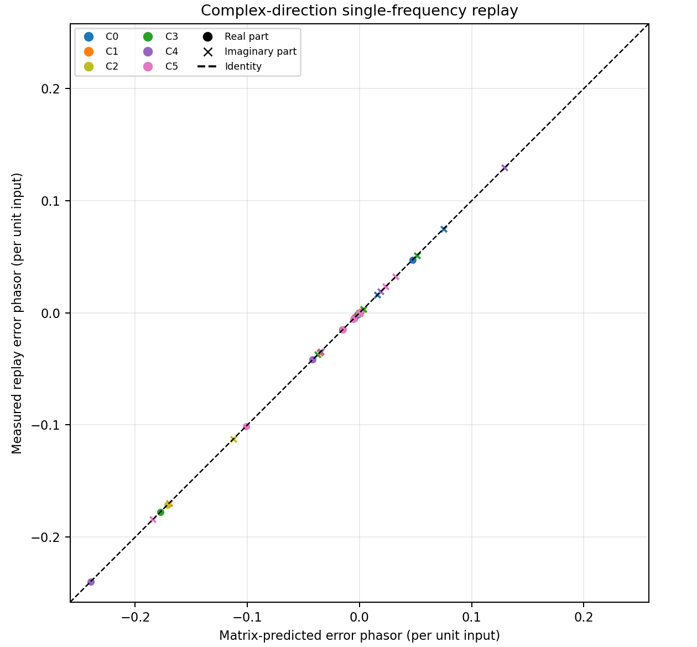
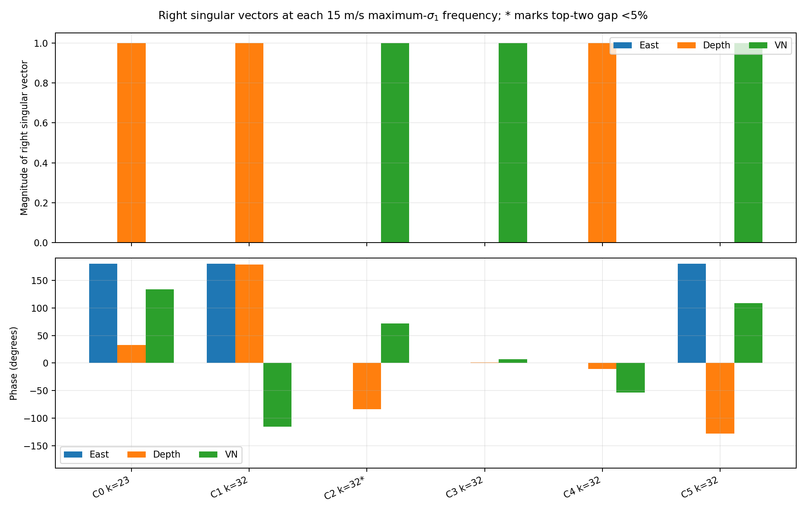
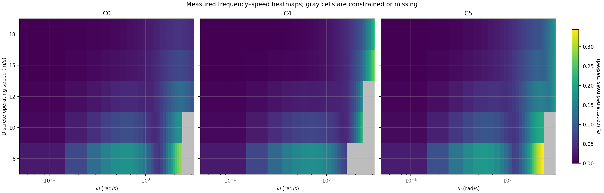
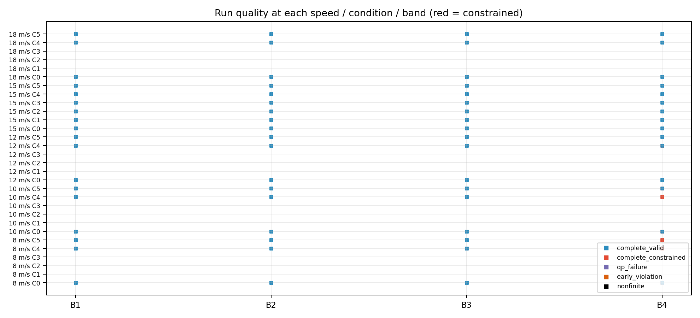
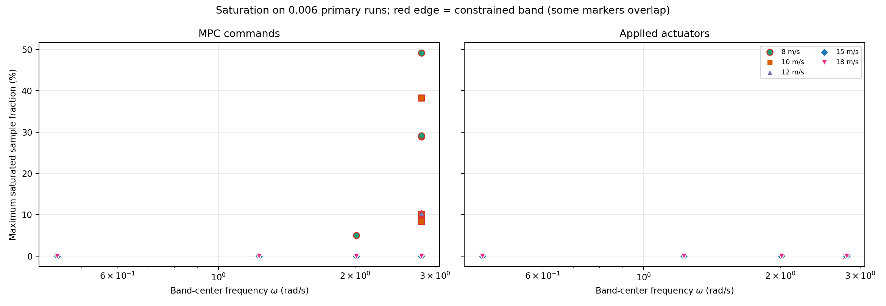
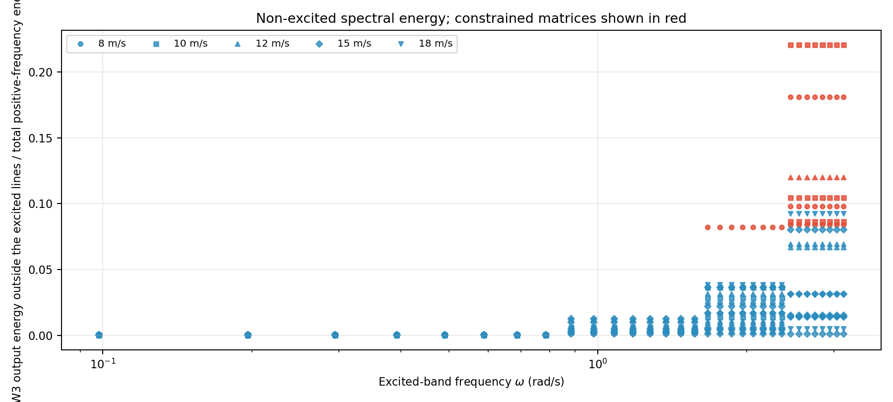

# GS-12：MPC 局部闭环频响扩展实验分析与 RL 设计启发

## Material Passport

- **材料与对象**：GS-12 的确定性直航闭环仿真；分析已有方案、运行记录、复频响矩阵和图表。
- **核查状态**：已读取 `frequency_extension/summary.json`、`protocol.json`、方向重放记录并独立汇总关键矩阵指标；**没有重新运行 360 条 MPC 闭环轨迹**。
- **主要来源**：[进一步分析](GS-12_进一步分析.md)、[扩展实验方案](GS-12_局部频响扩展实验方案.md)、[原结果摘要](frequency_extension/results.md)、[机器可读汇总](frequency_extension/summary.json)、[协议](frequency_extension/protocol.json)。下文数值均来自该批确定性数据；表中增益是无量纲的归一化增益。

## 1. 研究问题：为什么看参考到误差的频响

已有大幅机动实验表明，舵效降低、执行器变慢或变为二阶时，失配风险随**机动、航速和通道**改变；一个标量“模型误差百分比”无法解释这些变化。早期 7 个频点的局部实验在 15 m/s 发现，组合失配 C4 的误差敏感方向多为深度，保守预测器 C5 可降低当时已测最高频点的增益，却抬高较低频段的增益。这引出三个具体问题：7 个点之间和上边界之外是否遗漏重要响应？收益与代价分别落在哪个物理方向？这种规律在不同航速和激励幅值下是否仍成立？

本实验辨识的是 **“带未来参考预览的 MPC 闭环参考生成器 → 跟踪误差”** 的经验复频响。它描述给定直航工作点附近，小幅周期参考如何传到误差：幅值回答“放大多少”，相位回答“误差相对参考滞后或超前多少”。MPC 同时包含状态反馈、参考前馈、约束和 warm start，因此这里的矩阵不能直接称为标准输出反馈灵敏度 $(I+GC)^{-1}$，也不能当作鲁棒稳定性或 $H_\infty$ 范数证明。

## 2. 原理：从三种物理参考到 $3\times3$ 复矩阵

三个独立输入为东向位置、深度和北向速度参考，按工程尺度写成

$$z=[E_{ref}/8\mathrm{m},\ (D_{ref}-20\mathrm{m})/5\mathrm{m},\ (V_{N,ref}-U_0)/(2\mathrm{m/s})]^\top.$$

输出误差用同样尺度归一化：$e=[(E_{ref}-E)/8,\ (D_{ref}-D)/5,\ (V_{N,ref}-V_N)/2]^\top$。速度参考同时积分为北向位置参考；位置参考的导数和路径切线又生成速度、姿态参考，所以送入 MPC 的八维参考保持运动学一致。每次只激励 $z$ 的一轴，得到复矩阵 $T(j\omega)$ 的一列；三轴合起来有 $e(j\omega)\approx T(j\omega)z(j\omega)$。

在每个 64 s 的整周期窗口内，从激励轨迹减去**相同植物、控制器、初态与时长**的零激励基线，然后取复 Fourier 系数 $E_{i,k}$ 和 $Z_{j,k}$，令 $T_{ij}(j\omega_k)=E_{i,k}/Z_{j,k}$。对每个 $T=U\Sigma V^*$：

- $\sigma_1$ 是归一化输入范数为 1 时，该频点可能出现的最大误差增益；不是某条单独误差曲线，也不是稳定裕度。
- 右奇异向量 $v_1$ 指最敏感的**复参考方向**，其分量含相对相位；左奇异向量对应误差方向。若 $\sigma_1$ 和 $\sigma_2$ 接近，单独的 $v_1$ 可旋转，应看敏感子空间。
- 固定物理方向的 $\|Te_E\|_2$、$\|Te_D\|_2$、$\|Te_V\|_2$ 更容易回答“东向、深度或速度哪个参考导致误差”。归一化尺度若改动，奇异值和奇异向量也会改变。

## 3. 实验方法与质量控制

| 项目 | 实际设计 |
| --- | --- |
| 闭环与植物 | `CondensedActuatorMPC`，预测时域 $N=35$，控制周期 0.1 s；真实植物每周期 5 个 0.02 s RK4 子步。固定权重、约束与直航初态；无 RL、海流、噪声及随机参数。 |
| 工作点 | 15 m/s 测 C0–C5；8、10、12、18 m/s 测 C0、C4、C5，共五个**离散**航速。 |
| 频率 | $\omega_k=2\pi k/64$，$k=1\ldots32$，即 0.09817–3.14159 rad/s；每 8 条线分一组 B1–B4。旧 7 点是 $k=2,4,6,8,12,16,24$。 |
| 激励 | 每条频线主幅值 0.006，分别相当于东向 4.8 cm、深度 3 cm、北向速度 0.012 m/s；八线多正弦共用预设相位，前 16 s 平滑启动。另测 0.003 半幅和第二相位。 |
| 记录与估计 | 每条 256 s；W1、W2、W3 分别为 64–128、128–192、192–256 s，各 640 个控制周期末样本；主矩阵取 W2/W3 的复数平均。 |
| 工程判据 | W2/W3 逐频点矩阵差不超过 2%；半幅与主幅逐频点差不超过 5% 才称该幅值区间“近似线性”；命令或真实执行器饱和则标记为受约束经验响应。阈值是项目判据，不是统计显著性。 |

C0 是相对固定的 `MISMATCHED_PLANT` 的**预测匹配**基线。C1：双舵增益再乘 0.9；C2：推力和双舵的一阶时间常数均乘 2；C3：三通道改二阶；C4：双舵增益乘 0.9 且三通道二阶。**C5 与 C4 使用完全相同的真实植物**，只把预测器的双舵增益设为 0.85 倍、预测时间常数设为 2 倍。因此 C4/C5 是用于判断预测器改动的配对比较；C0–C4 用于理解植物变化。

本次共保存 360 条运行 JSON：346 条 `complete_valid`、14 条 `complete_constrained`，没有失败或提前终止。72 组预定主幅矩阵均完成；加上 32 组半幅和 9 组第二相位，共 113 组矩阵。113/113 组的 W2/W3 逐频点差都在 2% 内，最大仅 $3.05\times10^{-6}$。这说明稳态窗口重复性很高，**不自动说明幅值线性**。32 组半幅配对中，22 组满足 5% 判据，10 组超出。15 条独立单频复方向重放均完成，复误差向量相对矩阵预测的误差中位数 $5.69\times10^{-5}$，最大 4.37%；后者出现在 C2 的低频 $k=2$，不能用中位数遮盖。

## 4. 数据结果与图表解读

### 4.1 扩展频带后，15 m/s 的上边界仍重要

下表是主幅、主相位下，每个 B 频组实测点的最大 $\sigma_1$；**各列最大值未必发生在同一频点**。

| 15 m/s 条件 | B1：0.098–0.785 | B2：0.884–1.571 | B3：1.669–2.356 | B4：2.454–3.142 | 全 32 点最大及位置 |
| --- | ---: | ---: | ---: | ---: | --- |
| C0 匹配 | 0.0212 | 0.0551 | 0.0750 | 0.0729 | 0.0750，$k=23$ |
| C1 舵效下降 | 0.0122 | 0.0450 | 0.1370 | 0.1699 | 0.1699，$k=32$ |
| C2 全通道慢响应 | 0.0196 | 0.0453 | 0.1090 | 0.2049 | 0.2049，$k=32$ |
| C3 全通道二阶 | 0.0199 | 0.0401 | 0.0970 | 0.1850 | 0.1850，$k=32$ |
| C4 组合失配 | 0.0115 | 0.0401 | 0.1220 | 0.2724 | 0.2724，$k=32$ |
| C5 保守预测 | 0.0322 | 0.0839 | 0.1057 | 0.1850 | 0.1850，$k=32$ |

**读图**：C0 的最大值在 2.258 rad/s 附近，之后下降；C1–C5 的实测最大值位于当前网格上边界 $\pi$ rad/s。早期 7 点只到 2.356 rad/s：同一新协议下 C4/C5 在 $k=24$ 为 0.121974/0.104427，而到 $k=32$ 升至 0.272370/0.184985。由此可知，“旧 7 点最大值”低估了**这个新测量频带内**的最大值；边界外是否继续上升尚无数据。旧报告的 C4/C5 $k=24$ 数值为 0.121988/0.104493，与新协议对应点接近，但不能把不同多正弦相位与时间窗的整条曲线直接拼接。

### 4.2 C4/C5 的收益有明确频带代价

按同一真实植物、航速、频点和主相位配对，15 m/s 的 $\sigma_1(C5)/\sigma_1(C4)$ 在 B1 的八点全部为 **1.80–3.11**，B2 为 **2.09–2.68**；B3 从 $k=17$ 的 1.97 逐步降至 $k=24$ 的 0.856，排序在 $k=23$（约 2.258 rad/s）附近变化；B4 的八点均低于 1，范围 **0.675–0.753**。因此 C5 确实降低高频最大误差增益，但同时明显提高低中频最大误差增益。相对比值较大时也要看绝对值：例如 B1 的最大值是从 C4 的 0.0115 增至 C5 的 0.0322。

在 $k=32$，C4 的三种物理方向增益约为 `[0.2161, 0.2724, 0.1850]`（东向、深度、速度），C5 约为 `[0.1057, 0.1249, 0.1850]`。也就是说，保守双舵预测器显著压低了东向和深度误差，此频点的**速度方向转成 C5 最大增益的瓶颈**；速度列几乎不变。C5 的 $k=32$ 总增益是 C4 的 0.679 倍（降低约 32.1%），不能解释为所有通道都提高了 32.1%。在 $k=8$，C4 的最大方向接近东向（0.0115），C5 的最大方向接近深度（0.0322）；这说明只看 $\sigma_1$ 的大小还不足以理解代价落在哪个通道。

相位图用于判断某方向的误差在不同频率如何改变时序关系；相位不能简化成一个跨全频段的固定延迟。复数方向重放也证实了保留相位的必要性：以 $z(t)=a\operatorname{Re}[v\exp(j\omega t)]$ 重放时，15/15 条预测与真实闭环基本相符。15 m/s C2 的 $k=32$ 满足 $(\sigma_1-\sigma_2)/\sigma_1\approx2.06\%$，属于前两方向近重，单一“最危险向量”的方向不应被过度解释。

### 4.3 降速后，高频增益上升，但受约束结果要分层阅读

| 航速 m/s | C0 全带最大 | C4 全带最大 | C5 全带最大 | 主要质量信息 |
| ---: | ---: | ---: | ---: | --- |
| 8 | 0.3944† | 0.7192† | 0.4530† | C0/C4/C5 的 B4 受约束；C4 的 B3 也受约束。 |
| 10 | 0.1814 | 0.6698† | 0.2436† | C0/C4/C5 的 B4 受约束。 |
| 12 | 0.1209 | 0.3632† | 0.1869 | C4 的 B4 受约束。 |
| 15 | 0.0750 | 0.2724 | 0.1850 | 主幅矩阵均无约束。 |
| 18 | 0.0512 | 0.2277 | 0.1833 | 主幅矩阵均无约束。 |

† 该最大值所在矩阵含命令或真实执行器饱和，是**受约束的经验响应**，不能按无约束局部线性频响解释。10 m/s 的 C0 全带峰值在 $k=24$，虽其 B4 受约束，该峰值所在 B3 矩阵有效。

在固定绝对归一化尺度、相同控制器权重和相同频线幅值下，低速工作点通常出现更大的测得误差增益。舵力含速度平方项是一个**可能机制**；固定 3.5 s 预测窗的空间前视距离、初态配平、约束余量也随航速改变，数据不能把差异唯一归因于舵力。18 m/s 的增益较低同样不表示大幅任务更安全：已有机动实验表明，该速度附近的配平推力余量很小。

### 4.4 稳态重复、幅值依赖、相位依赖回答不同问题

半幅复核中，10/32 组超过 5% 工程阈值：8–12 m/s 的 8 组集中在 B3/B4，且其主幅矩阵都受约束；最大差是 **10 m/s C4-B4 的 68.8%**。另外 15 m/s 的 C0-B1、C5-B1 分别为 5.57%、5.98%，最大差均在最低频 $k=1$，对应主矩阵 Frobenius 范数仅约 0.00108/0.00134，绝对矩阵差约 $6\times10^{-5}/8\times10^{-5}$。这两项仍按预设规则报告为超阈值，但不宜与低速高频的大幅绝对变化混为同等工程影响。

第二相位在 15 m/s 的 C0/C4/C5 的 B1、B3、B4 做了 9 组复核。按主幅矩阵 Frobenius 范数归一化，逐频点最大相位组差分别约为：C0-B1 **2.72%**，C5-B1 **1.77%**，其余组合不超过 **1.04%**。C4-B4 的第二相位组包含一条受约束轴运行，提示多正弦相位的峰值组合可改变是否触碰约束；即使矩阵差只有约 1.04%，也不能忽略状态标签。未激励正频线输出能量占比的矩阵均值最高约 **0.221**（10 m/s C4-B4），提示非线性/互调或约束影响；它是谱描述量，并非独立噪声置信度或自动剔除标准。

## 5. 从 SVD 诊断到 MPC + RL：把结论变成待检验假设

1. **把频带和物理通道写进评价目标。** 只奖励最高频 $\sigma_1$ 下降，会偏向 C5 这样的高频收益，却漏掉 B1/B2 的 2–3 倍相对增益代价。可在开发阶段为若干选定频点、固定物理方向记录 $\|Te_j\|_2$、复相位和绝对差；同时保留大幅机动的越界、饱和与沿程误差指标。权重应由任务参考的实际频谱和容许误差决定，本实验不能替你给出统一权重。
2. **让 RL 识别工作点与约束状态。** 航速、推进/双舵实际位置、命令与实际执行器余量、可能的响应滞后可作为候选观测。它们对应数据中可见的速度依赖与受约束转变。若 RL 做 MPC 参数或残差调节，须在训练和评价时把无约束的小幅跟踪、饱和后的经验响应、大幅机动分别计分；受约束矩阵不能直接充当局部线性训练标签。
3. **优先考虑分通道、频带相关的修正假设。** C5 改的是双舵预测，却在 $k=32$ 留下速度方向瓶颈；旧分析中的二阶推进原型曾大幅降低速度方向增益，却恶化深度方向。两批结果共同支持“推进与双舵的模型修正/残差补偿分开设计”作为候选，而不是把所有通道统一乘一个保守因子。它仍是**设计假设**，需要新控制器的同植物全频带与大幅机动配对验证。
4. **用复方向做有针对性的 RL 压力评估。** 对已确认且不近重的敏感方向，可构造带相位的单频参考，比较 RL 加入前后完整复误差向量 $Tv$；近重处应测试对应子空间和预设物理方向。这比只报告某条时间轨迹的 RMSE 更容易定位 RL 改了哪个响应机制。当前 15 条重放支持矩阵在所测幅值下的预测能力，不代表 RL 已有效。

一个可执行的下一步是先固定 **15 m/s C4 真实植物** 和现有 MPC，把 RL 的作用限制在一个明确接口（例如分通道预测参数调节或有界参考残差），沿用同一 32 点、0.006/0.003、第二相位以及大幅机动配对协议。主要读数应同时包含 B1/B2 代价、B4 收益、$k=32$ 三个物理方向、饱和率和任务误差；再扩展到 12/18 m/s，最后单列 8/10 m/s 的受约束场景。这个顺序是基于现有证据的实验建议，不是对 RL 效果的预测。

### 5.1 进一步头脑风暴：RL 究竟可以改 MPC 的哪一处

下面是**研究假设清单，不是新增实验结果**。其中“分通道信任门控”已在[GS-12 RL 方案](../../docs/GS-12_RL文献与方案.md)和[执行清单](../../docs/GS-12_RL实验执行清单.md)中具体化；[GS-13 步骤](../../docs/GS-13_SR-PPO实验步骤.md)又给出了另一种训练与评估实现。本节主要用新 32 点结果调整这些想法的优先级，并提出几个可被简单规则反驳的备选接口。相关文献确实研究过 [RL 调 MPC 元参数](https://arxiv.org/abs/2111.04146)和[从候选权重集选择参数](https://arxiv.org/abs/2402.02624)，但其其他系统上的结果不能当作本 UUV 的性能证据。

| 点子及优先级 | RL 的动作与可得观测 | 为什么由本次频响想到它 | 最小对照与可证伪点 |
| --- | --- | --- | --- |
| **A. 预测器保守程度门控；优先** | 每约 0.5 s 选一个有界系数，在名义双舵预测与保守预测之间调节。观测为参考预览、航速、实际执行器、历史命令与预测创新。 | C5 相对 C4 在 B1/B2 明显变差、B4 明显变好；若任务频谱和已观测响应变了，固定一个端点可能并非全程合适。 | 先扫描固定系数，再比较根据**同一预览和历史**制定的确定性规则。若规则已经达到相同闭环代价和约束表现，就没有该接口的 RL 增益。两个端点各自有效不保证中间插值或切换有效，需直接测。 |
| **B. 分通道的模型/残差信任；优先，已有主线** | 维持现有方案中的少量门控，例如舵参数、纵向、升沉、横向四组；策略只看因果估计器及其质量、执行器与误差历史。 | $k=32$ 时 C5 的深度/东向改善而速度几乎不变，瓶颈转到速度；旧混合预测器又提示推进与双舵结构应分开。 | 同一个估计器/残差预测器下比较“全固定、仅舵门控、仅纵向门控、四维规则门控、四维 RL”。若收益只来自更好的监督预测器或固定门控，不归给 RL。特别检查残差是否重复补偿已改动的模型。 |
| **C. 选择少量已实测的 MPC 配置；可做轻量基线** | 策略在少数已完成本植物配对测试的预测器配置中选一个，而非连续调全部参数；输入同 A。 | C4/C5 的交叉频率清楚，离散选择能先问“能否利用上下文”，避免一开始搜索高维动作。 | 先做固定最佳配置和基于参考预览的显式切换规则；记录切换前后命令、QP、误差与饱和。若切换瞬态抵消稳态频响收益，停止这一方向。不能把静态 C4/C5 两张矩阵拼成切换控制器的频响。 |
| **D. 频响引导的训练场景与评价；优先，但它不增加在线控制动作** | RL 接口保持 A 或 B；训练参考加入 B1/B2、B4、固定物理轴和已测复敏感方向的混合，评价留出未训练频点、相位与大幅机动。 | 只在最高频训练会鼓励“改善 $k=32$、牺牲低中频”；C2 的近重方向又说明单一冻结奇异向量不够。 | 与完全相同 RL 接口、预算下的普通场景采样比较。若跨频段/机动配对结果无改善，就不保留复杂采样器。训练奖励初版仍用可解释的时间域任务指标，频响主要用来选场景和诊断。 |
| **E. 参考形状或预瞄调节；条件路线** | RL 只调一个允许范围内的参考变化速率、预瞄尺度或频带限制，MPC 仍求命令；观测含未来参考几何和执行器余量。 | C4 在高频增益较大，任务若允许改变参考时间安排，减少不可跟踪的高频需求可能比硬追踪更有效。 | 与固定低通、曲率规则和确定性速度治理配对；始终按**原始任务参考、进度与完成时间**评价，单列因改变参考而产生的滞后。若任务时间表不可改，此路线不适用。 |
| **F. 少量代价权重或预测时域调节；后置** | 从事先测过的少数权重/$N$ 组合中选择，观测工作点与参考预览。 | 航速变化使固定 3.5 s 预测窗的空间前视距离变化，可能有上下文调节空间。 | 先做固定网格与速度/几何规则。旧实验中单独增加 pitch 权重曾使目标深度方向变差，因此不预设“加大权重即改善”。若固定或规则组合已足够，或求解时间明显升高，就不训练策略。 |
| **G. 直接命令残差或在线主动激励；暂缓** | RL 直接叠加推力/舵命令，或故意加探测动作以辨识模型。 | 理论上能补偿模型遗漏或增加可辨识性，但本批数据没有证明命令层存在比预测器门控更好的剩余控制空间。 | 须先证明 A/B/C 均无法利用现有观测，并用同等命令约束、实际执行器余量和任务指标比较。当前没有足够证据支付额外动作接口、调参和归因成本；[其他平台的残差 MPC 研究](https://arxiv.org/abs/2510.12717)仅说明该架构可研究，不说明适用于高速 UUV。 |

这里的“频带条件化”不能偷用实验标签：B1 的周期为 8–64 s，而 MPC 只预览未来 3.5 s，短预览不一定能辨别低频成分。策略可以使用任务本来公开的较长参考计划或较长**因果**历史；若部署时两者都不可得，就应让 A 依据可观测响应与余量做决策，而不声称它实时识别了 B1/B4。训练和评价要使用同一信息边界。

**我会先试的最小问题是 A 与 D 的组合**：保持 15 m/s、C4 真实植物、同一 MPC 和现有参考生成器，仅开放一个舵预测保守系数；先得到固定系数曲线与显式预览规则，再训练同信息的低维策略。评价时同时问三件事：B1/B2 代价是否下降、B4 收益是否保留、大幅机动的首次越界与饱和是否恶化。若单系数确有收益空间但速度方向继续成为瓶颈，再进入 B 的纵向分支。这样能把“RL 是否学到了上下文选择”与“增加了更多模型/残差能力”分开。

**频响测量口径也要随策略改变。** 固定系数、固定模型时可沿用本报告的局部矩阵；策略若随历史、参考或 0.5 s 时钟变化，三轴激励可能触发三条不同的门控轨迹，拼出的 $3\times3$ 数组只应叫“该激励协议下的逐轴经验响应”。可另做“先适应、再锁定门控”的条件矩阵；动态策略则同时报告门控轨迹、未激励频线/边带能量、半幅与时钟相位敏感性。这个区别在现有[GS-12 执行清单](../../docs/GS-12_RL实验执行清单.md)中也已提出，是解释 RL 频域结果的必要前提。

### 5.2 更聚焦的研究故事：SVD 指方向，RL 学习何时调整预测器

**一句话研究问题：** 能否用局部闭环复频响的 SVD 找出“哪个频率、哪种参考组合最易变成误差”，再让只使用因果信息的 RL 门控调整 MPC 预测器，使任务相关的敏感方向误差下降，同时不把代价转移到其他频带、物理方向或大幅机动？这把频域分析放在**动作设计、训练场景和机制验证**三个位置，而不只是训练完成后的附加图。

**第一环：从“最大值”转成“方向性矛盾”。** 15 m/s、$k=32$ 时，C4 的最大误差方向主要是深度，$\sigma_1=0.2724$；C5 把东向/深度方向压低后，速度方向的约 0.1850 成为最大值。反过来，$k=16$ 时 C4 的最大值对应速度（约 0.0401），但东向值约 0.0388、两方向接近；C5 的最大值转为深度（约 0.0839）。所以核心现象并非“C5 总是好或坏”，而是**预测器改动重排了不同频率上的误差方向**。研究目标可具体写成：减少任务常见的低中频深度代价，保留高频东向/深度改善，并检查速度方向是否成为新的限制。

**第二环：先证明 RL 的动作确实能改变这些方向。** 现有 C4/C5 只给出两个控制器端点，不能推断中间保守系数的增益单调，也不能从 $v_1$ 直接推断“该调哪个 MPC 参数”。先在相同 C4 植物上冻结若干双舵预测系数 $\alpha$，分别重测 $T_\alpha(j\omega)$，保留三种读数：

1. $\sigma_1(T_\alpha)$：每个配置自己的最坏归一化方向；
2. $\|T_\alpha e_E\|_2,\|T_\alpha e_D\|_2,\|T_\alpha e_V\|_2$：固定的物理方向，防止奇异向量转动后误判；
3. $\|T_\alpha v_{C4,k}\|_2$ 和复向量 $T_\alpha v_{C4,k}$：固定 C4 的敏感复方向，观察原本的问题是否真的被修正。

若只想用局部导数筛选动作，在**首奇异值独立且参数扰动足够小**时，可把 $\operatorname{Re}[u_1^*(T_{\alpha+\delta}-T_\alpha)v_1]/\delta$ 当作 $\sigma_1$ 对动作的局部变化近似；实际闭环仍需复测，不能把这个投影当成完整控制效果。C2 在 $k=32$ 的首两奇异值差只有约 2.06%，该处不解释单个向量导数，而直接比较前两维敏感子空间、固定物理方向和重测的 $\sigma_1$。若参数扫描显示某动作在目标方向几乎不起作用，就不应把它交给 RL 学。

**第三环：RL 的贡献是有条件的取舍，而非重新发现一个固定参数。** 策略可以依据可得的参考计划、实际执行器/队列、航速及历史预测创新，低频选择一个或少数几个模型信任系数；MPC 继续负责每 0.1 s 的状态预测、QP 和命令。只有当不同工作点或任务片段对 $\alpha$ 的优选存在可观测的冲突，而且 RL 在相同信息下超过**开发集最佳固定系数**与**显式上下文规则**，才有理由说学习到的时变决策有独立价值。在单一固定植物、单一已知正弦频率下，按频率查表就可能足够；那是有用的非 RL 结论，不应硬包装为策略学习收益。

**第四环：频域指标与任务指标要对应。** 对固定 $\alpha$ 或“先适应再锁定”的策略，可将已测频点的 $\sigma_1$ 和上述固定方向增益画成性能曲面 $G(\omega,\alpha)$；预先按任务参考的频谱与误差容限选重点频段。对持续动态门控，频率转换、边带和时钟相位本身可能成为响应的一部分，不能再宣称一个统一的 LTI $T(j\omega)$。训练初版可继续用时域误差、饱和和越界回报；SVD 用来选择参考激励、设置消融和解释失败。最终同时报告：① 锁定后的条件矩阵；② 动态策略的逐轴经验响应、边带及门控轨迹；③ 相同大幅机动下的首次越界、任务误差和执行器饱和。若只改善 SVD 图而任务表现变差，这个故事就被实验否定。

这条主线的可检验贡献是**“局部方向性诊断 → 验证可调接口的方向作用 → 学习上下文取舍 → 用同一方向和真实任务复核”**。现有数据完成了第一步，并给出 C4/C5 两个端点的提示；后续三步仍需新实验，不能把目前的 SVD 图写成已证明 RL 有益。

若用于组会或论文引言，可以按四幅图讲述，避免先介绍算法再寻找动机：

| 叙事图 | 要回答的问题 | 目前证据状态 |
| --- | --- | --- |
| 图 1：$\sigma$ 曲线 + $v_1$ / 物理列方向 | 固定 MPC 在哪些频率和方向暴露失配？ | **已有**：C4/C5 的 32 点矩阵、方向和质量标记。 |
| 图 2：$G(\omega,\alpha)$ 与固定 C4 敏感方向的响应 | 选定 MPC 参数是否真能改变该方向，代价转移到哪里？ | **待做**：同植物的少量固定参数扫描及半幅复核。 |
| 图 3：参考/响应上下文与 RL 门控轨迹 | 策略何时选不同参数，选择是否超出固定或规则方案？ | **待做**：同信息基线与动态门控配对；先确认任务中确有选择冲突。 |
| 图 4：条件频响 + 动态经验响应 + 大幅机动 | 频域的方向收益能否转化为真实任务收益？ | **待做**：锁定/动态两种口径、边带、约束和任务指标共同报告。 |

## 6. 结论边界与复现入口

这批数据证明的是：在指定直航工作点、确定性植物、参考生成器、频率网格及激励幅值下，局部经验频响可稳定测得，并揭示了 C4/C5 的清晰频带取舍、最敏感物理方向的变化，以及低速高频的约束与幅值依赖。它**没有**证明闭环的全局稳定性、随机鲁棒性，也没有测量转弯、持续升沉、海流、传感噪声、真实硬件或已加入 RL 的性能。32 条频线、重复周期和 360 条预设运行不是独立随机样本，不能据此给出失效概率或统计置信区间。

复查可从 [原结果摘要](frequency_extension/results.md) 和 [全部矩阵](frequency_extension/matrices/all_matrices.json) 开始；[原始运行](frequency_extension/runs/) 与 `frequency_extension/traces/` 保存每条闭环信息。分析脚本为 `frequency_extension_src/run_frequency_extension.py` 的 `analyze` 阶段；重新分析前应保留原始输出及协议哈希，避免与本报告引用的记录混淆。
