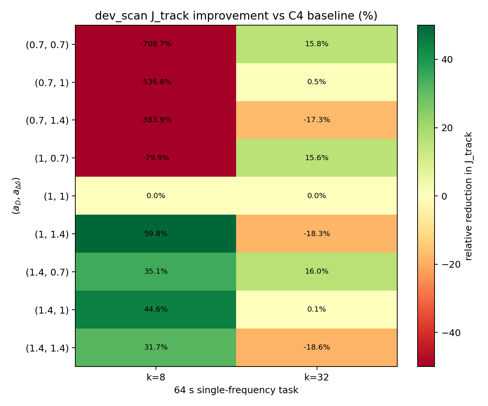
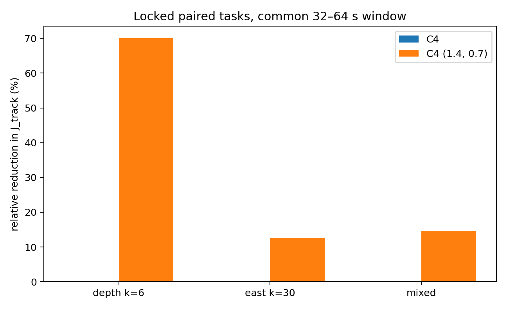
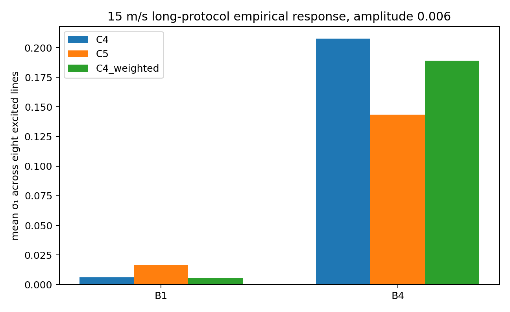

# GS-12 频谱感知 MPC 权重调节：实验报告

**日期：** 2026-11-11（Asia/Shanghai）  
**Material Passport：** `GS12-WEIGHT-ROUTE-2026-11-11`  
**实验类型：** 确定性闭环仿真、静态 MPC 代价调参、经验频响复核  
**状态：** 预设留出门槛通过；完成可选 B1/B4 长协议矩阵复核。

## 1. 问题与结论

本实验检验：在同一 15 m/s C4 真实植物上，调整深度跟踪权重与双舵命令变化惩罚，能否改善未参与调参的任务。候选倍率为

\[
(a_D,a_{\Delta\delta})=(1.4,0.7),
\]

其中 `a_D` 乘到 MPC 深度状态权重，`a_Δδ` 乘到每个预测阶段的两个舵面归一化命令变化权重；其他代价、硬约束、预测器、植物和数值设置保持路线规定值。

候选在三条锁定任务上相对原始 C4 的任务等权平均 `J_track` 降低 **13.46%**。三条任务的 `J_track` 均未恶化，所有 9 条 C4/C5/候选运行均完整结束，没有新增诊断越界、QP 失败或命令/实际执行器饱和。因此它通过预设的 5% 工程门槛。证据范围限于本报告中的 C4 植物、15 m/s 和冻结任务。

锁定测试后还完成 39 条 256 s 运行。B1、B4 的经验频响矩阵周期复现和全/半幅一致性均良好；加权候选在两段频带的平均 `σ₁` 都低于原始 C4。结果支持固定权重调参的局部收益，不支持加入动态频谱规则：开发集未显示不同频带需要不同最优配置，也没有证据证明动态策略能超过固定候选。

## 2. 固定条件与指标

- **真实植物：** `PlantConfig(elevator=.9, rudder=.9, order="second_all")`，与 C4 一致；三种控制器均使用同一个真实植物。
- **预测器：** C4 为原模型；C5 参照固定为 `model_gain=.85, model_tau=2.`。C5 是预测器偏置参照，不能把它的差异归因于权重。
- **MPC：** 22 状态，`dt=0.1 s`，35 步预测时域；植物每个控制周期推进 5 个 `0.02 s` 子步。
- **扫描：** `a_D × a_Δδ={0.7,1.0,1.4}²`；`dev_scan` 为 64 s 单频深度参考 `k=8,32`，主窗口 32–64 s。
- **混合开发集：** 两条 64 s 低→高→低参考，过渡分别约在 20/40 s 和 22/42 s；解析速度导数包含平滑混合包络导数。
- **锁定集：** 深度 `k=6`、东向 `k=30` 和一条切换参数不同的混合任务；任务和相位在扫描之前冻结，候选则在开发集复核后冻结。
- **主要评分：**

\[
J_{\mathrm{track}}=\operatorname{mean}\left[
  ((E_r-E)/8)^2+((D_r-D)/5)^2+((V_{N,r}-V_N)/2)^2
\right].
\]

早停比较使用所有配对方法的共同前缀；本批所有任务都完整结束，所以锁定集评分均覆盖 32–64 s。5% 是工程晋级门槛，不是统计显著性阈值。确定性频线、任务与时间步不视为随机独立样本，本实验不报告置信区间或失效概率。

## 3. 接线与运行质量

### QP 接线和 runner 对齐

- 参考解析导数对数值差分的最大绝对误差：`4.95e-5`。
- `a_D: 1→1.4` 改变了 QP Hessian 和 gradient（最大变化分别约 `50.41` 和 `0.0403`）。
- `a_Δδ: 1→1.4` 改变了 QP Hessian（最大变化约 `0.28`）；基准舵面计划为零，因此该诊断点的 gradient 变化为零，这是预期的代价结构结果。
- 同一 24 s C4 参考下，新旧 runner 的船体状态、输出、诊断量最大差均小于 `7e-14`；命令最大差 `8.9e-8`，QP 有效状态逐周期一致。
- 单条 B1/B4 长参考与历史参考生成器逐样本核对，六种频带/轴组合的最大差小于 `5e-13`。

### 吞吐与状态

| worker 数 | 同一组 4 条 64 s 任务墙钟时间 | 吞吐（条/s） | 单 worker 峰值 RSS | 任务状态 |
|---:|---:|---:|---:|---|
| 1 | 67.18 s | 0.0595 | 562 MB | 4/4 完成 |
| 2 | 37.32 s | 0.1072 | 560 MB | 4/4 完成 |
| 4 | 20.90 s | 0.1914 | 561 MB | 4/4 完成 |

后续批次使用实测吞吐最高的 4 worker。单 worker pilot 中 `mpc.solve` 的 p95 延迟中位数为 28.35 ms、最大 p99 为 31.54 ms。它是求解器计时，不包含完整外部控制栈，也不是实艇实时性保证。

| 阶段 | 运行数 | 完整 | 早停 | QP 失败 | 缺项 |
|---|---:|---:|---:|---:|---:|
| `dev_scan` | 20 | 20 | 0 | 0 | 0 |
| `dev_rule` | 8 | 8 | 0 | 0 | 0 |
| `test_locked` | 9 | 9 | 0 | 0 | 0 |
| 256 s 长协议 | 39 | 39 | 0 | 0 | 0 |

## 4. 开发扫描与候选冻结

按两个开发任务的等任务相对变化排序，`(1.4,0.7)` 的平均改进为 **25.55%**，其中 `k=8` 改善 35.08%、`k=32` 改善 16.02%。另一正向扫描候选 `(1.0,1.4)` 虽然扫描均值为正，但在 `k=32` 退化 18.29%，不满足跨开发任务的稳定改善预期。

在两条混合开发任务中，`(1.4,0.7)` 相对 C4 分别降低 `J_track` **14.57%** 和 **14.83%**；`(1.0,1.4)` 则分别退化 16.83% 和 16.91%，因此被剔除。两类开发参考都支持同一个静态候选，没有形成“低频/高频偏好不同”的证据，按路线跳过动态频谱规则。



## 5. 锁定留出结果

候选在运行锁定任务前冻结为 `(1.4,0.7)`，比较原始 C4、预测器参照 C5 和固定权重候选。正式门槛比较 C4 与候选的**平均任务代价**：

| 锁定任务 | `J_track` C4 | `J_track` 候选 | 单任务相对下降 | 状态 |
|---|---:|---:|---:|---|
| 深度 `k=6` | `6.917e-10` | `2.076e-10` | 69.98% | 完整、无 QP 失败 |
| 东向 `k=30` | `6.644e-7` | `5.811e-7` | 12.54% | 完整、无 QP 失败 |
| 混合参考 | `5.169e-7` | `4.416e-7` | 14.56% | 完整、无 QP 失败 |
| **任务等权平均** | **`3.940e-7`** | **`3.410e-7`** | **13.46%** | **通过 5% 门槛** |

正式门槛使用 `1 - mean(J_candidate)/mean(J_C4)`，不是三个单任务百分比的算术平均。三个任务均未恶化；C4 与候选均为 0 QP 失败、0 命令饱和、0 实际执行器饱和，也无早停。

各通道 RMSE（东向和深度为 m，北向速度为 m/s）：

| 任务 | 方法 | RMSE E | RMSE D | RMSE VN |
|---|---|---:|---:|---:|
| 深度 `k=6` | C4 | 0 | `1.315e-4` | `3.214e-7` |
|  | 候选 | 0 | `7.205e-5` | `3.080e-7` |
| 东向 `k=30` | C4 | `6.521e-3` | 0 | `1.699e-5` |
|  | 候选 | `6.097e-3` | 0 | `2.443e-5` |
| 混合参考 | C4 | `3.587e-3` | `2.810e-3` | `1.914e-5` |
|  | 候选 | `3.347e-3` | `2.581e-3` | `2.324e-5` |

东向和混合任务的北向速度误差在候选下略有增加，尽管外部 `J_track` 仍降低；因此结果应表述为预设**综合指标**的改善，而不是每一个通道都改善。锁定集内候选 `mpc.solve` p95 约 29.1–32.5 ms（4 worker，有并行资源争用）。



## 6. 256 s B1/B4 经验频响复核

锁定门槛通过后，按长协议在 15 m/s 运行 39 条轨迹：C4、C5、固定候选 × B1/B4 × 三输入轴 × 全幅/半幅，加每个控制器自己的零输入基线。评价使用 128–192 s 和 192–256 s 两个稳态窗口，报告其复数矩阵平均；主激励幅度 `0.006`、半幅 `0.003`。

| 频带 | 方法 | 全幅平均 `σ₁` | 全幅峰值 `σ₁` | 半幅/全幅矩阵差 | W2/W3 最大周期差 |
|---|---|---:|---:|---:|---:|
| B1 | C4 | 0.006191 | 0.011545 | 0.193% | `2.39e-7` |
| B1 | C5 | 0.016733 | 0.032166 | 0.382% | `1.18e-7` |
| B1 | 固定候选 | 0.005306 | 0.010921 | 0.211% | `2.74e-7` |
| B4 | C4 | 0.207564 | 0.272370 | 0.038% | `7.28e-11` |
| B4 | C5 | 0.143589 | 0.184985 | 0.045% | `1.26e-10` |
| B4 | 固定候选 | 0.189107 | 0.249584 | 0.036% | `9.25e-11` |

固定候选相对 C4 的 `σ₁` 均值在 B1 降低约 14.3%、B4 降低约 8.9%；该局部频响差异与固定候选跟踪误差改善方向一致。C5 在 B4 的差异来自预测器失配参照，不归因于代价权重。所有 12 个矩阵组的 W2/W3 周期差都远低于历史 2% 质量阈值，全/半幅差均小于 0.4%。

这些是受控仿真下“参考→跟踪误差”的经验频响，不是灵敏度函数、鲁棒稳定性或实艇安全证明。确定性频线和时间窗口也不是独立样本。



## 7. 解释边界与下一步

1. 固定权重候选在此冻结留出集通过预设工程门槛；证据仅覆盖 C4 植物、15 m/s、给定三条任务和给定采样/预测设置。需要更广任务与速度的独立留出，才能判断可迁移性。
2. 锁定综合代价通过不意味着三个误差通道都不退化。报告保留了速度 RMSE 的小幅退化，不能只引用总分。
3. 没有实现频谱规则或 RL。路线规定静态频带取舍成立后才做动态规则；本次开发任务偏好同一固定候选，按止损条件保留静态结果。
4. 长协议矩阵没有改变测试集或重新调候选，只作为锁定通过后的补充复核；不应把 39 条轨迹解读为随机化泛化统计。

## 8. 文件、复现与完整性

- 冻结主协议/任务：[`output/protocol.json`](output/protocol.json)、[`output/tasks.jsonl`](output/tasks.jsonl)。
- 冻结候选及门槛计算：[`output/selection.json`](output/selection.json)、[`output/test_locked_decision.json`](output/test_locked_decision.json)。
- 任务级原始指标：[`output/dev_scan_metrics.csv`](output/dev_scan_metrics.csv)、[`output/dev_rule_metrics.csv`](output/dev_rule_metrics.csv)、[`output/test_locked_metrics.csv`](output/test_locked_metrics.csv)。
- 长协议：[`output/long_protocol.json`](output/long_protocol.json)、[`output/long_matrix_metrics.csv`](output/long_matrix_metrics.csv)、[`output/long_matrix/long_matrices.json`](output/long_matrix/long_matrices.json)。
- 完整轨迹以每次运行独立 `.npz` 保存，并由 `.json` 中 SHA-256 校验；最终审计见 [`output/integrity_audit.json`](output/integrity_audit.json) 和 [`output/source_manifest.json`](output/source_manifest.json)。

运行主批次前的 runner 一致性、QP 接线和参考导数检查：

```bash
python3 experiments/gs12_weight_route/verify_route.py
```

完整新运行目录命令和环境变量说明见 [`README.md`](README.md)。本次运行 ID 最终按“协议 SHA、数据划分、任务、控制器、权重策略、幅值、相位”组成；完整性审计阶段只按该主键迁移了运行文件名与 JSON 元数据，**未修改 NPZ 轨迹内容**，之后重新验证全部轨迹哈希。
