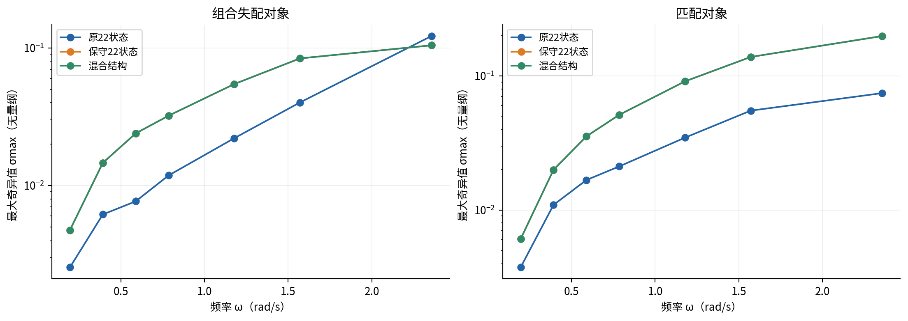
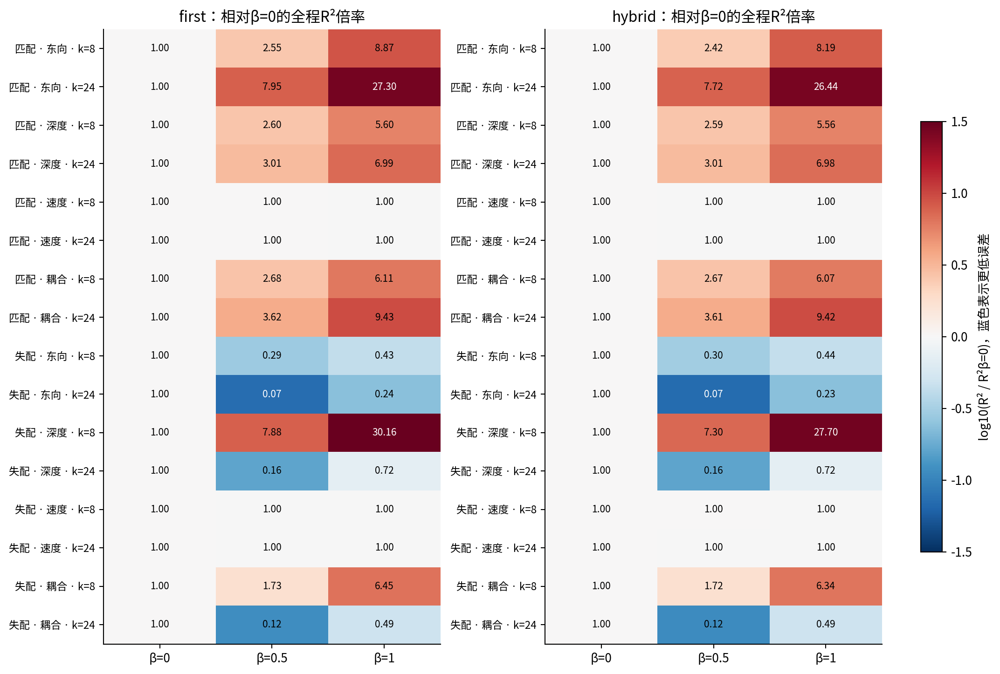
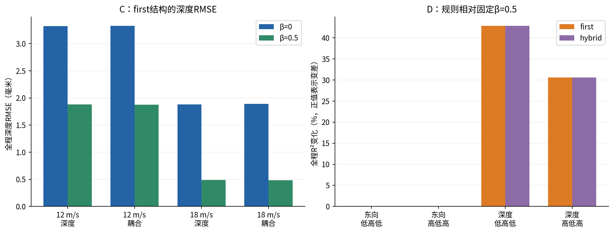

## Material Passport

- Origin Skill / Mode：academic-research-suite / experiment-agent validate
- Date / Version：2026-11-13 / gs21_results_v1
- Verification Status：ANALYZED；本轮离线复核保存数据，未重新运行闭环仿真或训练。
- Scope：GS-12 原结论的阶段 A 复现，以及 GS-21 轻量版 B–D；E/F 按预设门槛未触发。

# GS-12 延续实验：结果与数据报告

**已确认的结果是：原组合失配条件下的频响取舍得到复现；适中的固定保守参数在部分路径上降低了实际跟踪误差；本次规则调度没有进一步获益，因此没有开展 PPO 训练和策略留出评价。**

本报告将阶段 A 与后续轻量实验合并说明，独立复核了 **260 条正式闭环记录**。其中包含提前终止的机动记录，不能理解成260条均完成的路径。原大规模 B/C 尝试的7条记录单独归档，不并入轻量版结果。历史 GS-12 数据只作复现参照，不重复计入样本。

| 核心问题 | 当前证据 | 结论边界 |
|---|---|---|
| GS-12 的频响取舍是否还在？ | 组合失配对象最高频最大奇异值降低14.3%，前六个频点更差 | 已在原局部频响条件下复现 |
| 是否能转化为物理RMSE改善？ | 固定β=0.5在开发集平均归一化误差低约20%；四个迁移任务低约78.7%，分项RMSE也降低 | 依赖对象、方向和频带，并非逐路径都更好 |
| 动态调度能否超过固定参数？ | 两种结构各0胜、2平、2负；规则平均误差高约25.5% | 本次规则未显示增量收益 |
| RL是否有效？ | 未达到进入PPO的预设门槛，未训练、未做策略留出评价 | 当前没有RL效果结论 |

## 1. 实验主线与统一口径

这系列实验沿用原UUV植物、MPC权重、约束、35步预测时域及0.1秒控制周期。真实对象以0.02秒子步积分。比较的两个预测结构为：

| 名称 | 预测结构与参数 |
|---|---|
| `first` | 原22状态、一阶执行器预测器 |
| `hybrid` | 二阶推进预测＋一阶双舵预测；推进速率采用原因果观测器 |
| β | 只调双舵预测参数：舵效倍率 `1−0.15β`，时间常数倍率 `1+β` |
| β=0 / 0.5 / 1 | 舵参数分别为 `1/1`、`0.925/1.5`、`0.85/2` |

`matched` 表示真实对象与原一阶预测模型匹配；`combined` 表示真实双舵效能×0.9、所有执行器采用二阶动态；`combined_tau` 再将执行器时间常数×1.2。“保守”指预测器参数的设置，不表示真实对象同步改变，也不预设性能一定更好。

### 指标怎样读

对误差 `e = 参考−输出`，物理RMSE为同一时间窗口内 `sqrt(mean(e²))`。位置单位为米，速度为m/s，姿态为rad；下文部分位置误差换算成毫米以便阅读。完整分项表仍保留原单位。

本实验的无量纲综合评分是：

`R² = mean[(eE/8)² + (eD/5)² + (eVN/2)²]`，`R = sqrt(R²)`。

这里R²是归一化平方误差的记号，**越小越好**。只有东向、深度、北向速度三项参与该评分；北向位置、姿态和其他速度分量另报。跨任务选参采用任务等权的平均R²。报告中的“降低78.7%”指该平方误差评分，不等于每个物理RMSE都降低78.7%。

频响矩阵则描述特定频率的参考振幅如何映射为跟踪误差振幅，按相同三量尺度归一化；最大奇异值 `σmax` 描述最坏参考组合方向的误差增益。它与全程RMSE、运行完成率分别回答不同问题。

全程评分包含启动和切换。单频稳态窗口为16秒之后，桥接频响采用80–144秒；切换任务另列16–46、50–94、98–144秒及46–50/94–98秒过渡窗口。提前终止记录只保留已观测误差，不参加完整轨迹排名。

### 实际覆盖范围

| 阶段 | 任务与方法 | 正式记录数 | 当前状态 |
|---|---|---:|---|
| A：频响桥接 | 两种对象×零/东向/深度/速度，三种方法，144秒 | 24 | 全部完成 |
| A：原机动对照 | 三航速×三种对象×四类机动，三种方法，24秒 | 108 | 已运行，含14条提前终止记录 |
| 轻量B：固定β | 两种对象×四方向×两频带，两结构×三档β，64秒 | 96 | 全部完整、无记录到的QP失败或饱和 |
| 轻量C：迁移 | 12/18 m/s×深度/耦合，两结构×β=0/0.5，64秒 | 16 | 全部完整、无记录到的QP失败或饱和 |
| 轻量D：切换 | 东向/深度×两种频率顺序，两结构×固定/规则，144秒 | 16 | 全部完整、无记录到的QP失败或饱和 |
| E/F | PPO试跑与冻结后的策略留出评价 | 0 | 门槛未满足，按轻量计划停止 |
| **合计** |  | **260** | 轻量B–D共128条 |

轻量方案由用户要求缩小原方案后制定并执行；它替代了本轮原大规模B–F的任务范围。结果不应再表述为“仍欠原方案约4900次运行”，也不能表述为原大规模网格已经完成。

## 2. 阶段 A：原结论复现与机动完成情况

### 2.1 三轴频响已补齐，复现通过

最初仅有零激励和东向数据，缺少完整矩阵的深度、速度两列。随后已补齐两种对象的全部三轴激励，因此“FRF因缺轴无法计算”只适用于早期试跑。

原22状态频响矩阵与GS-12旧数据的逐频相对Frobenius差异，组合失配对象最大为 **2.285×10⁻⁹**，匹配对象最大为 **1.537×10⁻⁹**，均小于协议阈值10⁻³。本报告重新从原始轨迹构建矩阵，并复核了全部六组矩阵的两个时间窗口。

15 m/s组合失配对象的最大奇异值如下。

| 频率（rad/s） | 原22状态 | 保守22状态 | 混合结构 |
|---:|---:|---:|---:|
| 0.196 | 0.002546 | 0.004745 | 0.004745 |
| 0.393 | 0.006165 | 0.014618 | 0.014622 |
| 0.589 | 0.007681 | 0.023923 | 0.023926 |
| 0.785 | 0.011839 | 0.032174 | 0.032168 |
| 1.178 | 0.022083 | 0.054656 | 0.054642 |
| 1.571 | 0.040177 | 0.083945 | 0.083936 |
| 2.356 | 0.121988 | 0.104493 | 0.104463 |

**保守参数在前六个已测频点付出代价，在最高已测频点改善约14.3%。** 应限定为“最高已测频点”，不能据此声称整个高频区间都改善。匹配对象最高点则为0.074379→0.198229，说明该规律不能脱离失配条件推广。



混合结构在组合失配最高频点的纯速度参考列范数为0.007050，原22状态为0.096970，降低约92.73%；保守22状态仍约0.096970。这对应推进结构改变的局部收益，与动态β或整条路径RMSE改善率不同。

### 2.2 东向七频轨迹的物理误差

| 对象 | 原22状态全程东向RMSE（mm） | 保守22状态（mm） | 混合结构（mm） |
|---|---:|---:|---:|
| 匹配 | 3.891 | 7.013 | 7.014 |
| 组合失配 | 5.707 | 4.606 | 4.607 |

保守参数在匹配对象上更差，在组合失配对象上东向RMSE约低19.3%。这是含启动、含七个频率共同作用的单条轨迹评分，不能直接拿来替代逐频σmax。

### 2.3 原机动对照

36个工况覆盖12/15/18 m/s，匹配/组合/组合tau对象，以及直线速度变化、水平摆动、深度起伏、水平—深度耦合四类机动。

| 方法 | 完成数/36 | 完成比例 | QP失败次数 | 满足完整、无饱和资格的任务数 |
|---|---:|---:|---:|---:|
| 原22状态 | 23/36 | 63.9% | 2 | 6 |
| 保守22状态 | 35/36 | 97.2% | 0 | 6 |
| 混合结构 | 36/36 | 100% | 0 | 6 |

本批指定机动中保守/混合方案的完成覆盖更好。但各方法成功样本集合不同，且多数任务含饱和，因此不能用“各自完成任务的平均R²”给出总体精度排名。三种方法共同具备严格比较资格的任务只有6个。这里的36/36是有限仿真任务的完成结果，不是稳定性证明或实际失效概率估计。

## 3. 轻量 B：固定参数能否降低路径误差

16条开发参考覆盖匹配/组合失配对象、东向/深度/速度/耦合方向，以及 `k=8/24` 两频带。对应频率为0.785/2.356 rad/s，周期8/2.667秒。归一化幅值0.006对应东向4.8 cm、深度3 cm、速度0.012 m/s；耦合相位差为π/2，初相位固定0.31 rad。

两结构均从β=1启动，随后以每0.1秒最多0.02的速度趋向目标β。因此到β=0.5约需2.5秒，到β=0约需5秒；全程评分保留这些启动过程。阶段A则从各自端点开始，两个协议的绝对评分不直接合并。

| 结构 | β=0平均R² | β=0.5平均R² | β=1平均R² | β=0.5相对β=0降低 |
|---|---:|---:|---:|---:|
| first | 7.743×10⁻⁸ | **6.168×10⁻⁸** | 1.563×10⁻⁷ | 20.33% |
| hybrid | 7.699×10⁻⁸ | **6.117×10⁻⁸** | 1.557×10⁻⁷ | 20.54% |

两种结构均选出β=0.5，即舵效0.925、时间常数×1.5。但这是16条任务等权平均后的折中，**不是每条路径都偏好β=0.5，也不是连续β区间的最优解证明。**

以first结构的分组均值为例：

| 真实对象 | β=0平均R² | β=0.5平均R² | β=1平均R² |
|---|---:|---:|---:|
| 匹配，8条 | 2.594×10⁻⁸ | 9.141×10⁻⁸ | 2.368×10⁻⁷ |
| 组合失配，8条 | 1.289×10⁻⁷ | 3.196×10⁻⁸ | 7.588×10⁻⁸ |

匹配对象的东向、深度和耦合任务更偏好β=0；组合失配对象中，深度/耦合低频偏好β=0、高频偏好β=0.5；东向两频带都偏好β=0.5。同一结构内速度路径的β差异很小。各组绝对误差不同，整体均值的改善不能解释为对所有条件均改善。

物理误差例子更直观：组合失配、first结构的低频深度RMSE为 **0.085→0.311→0.621 mm**，高频为 **2.383→0.951→2.022 mm**，依次对应β=0/0.5/1。低频代价与高频收益并存，适中的保守程度也可能优于完全保守端点。



冻结的固定参数和规则保存在 `outputs/gs20_continuation/LB_selection.json`。规则按对象混合后的开发样本选择，东向k=8/24均为β=0.5，深度/耦合分别为β=0/0.5。它没有按真实失配标签分别选规则。

## 4. 轻量 C：少量航速与耦合迁移

本阶段保持B选出的β=0.5，不重新调参；在组合失配对象上检查12/18 m/s的深度/耦合四条高频路径，初相位为0.93 rad。航速和初相位均相对B改变，因此它是联合迁移检查，不能单独归因为航速变化的效应。四条任务均属于开发性检查，不是最终冻结后的策略留出测试。

| 结构 | β=0平均R² | β=0.5平均R² | 平均R²降低 | 逐任务胜场 |
|---|---:|---:|---:|---:|
| first | 4.172×10⁻⁷ | 8.875×10⁻⁸ | 78.73% | 4/4 |
| hybrid | 4.172×10⁻⁷ | 8.866×10⁻⁸ | 78.75% | 4/4 |

first结构的全程物理RMSE如下，单位均为毫米：

| 航速/方向 | 东向β=0→0.5 | 深度β=0→0.5 |
|---|---:|---:|
| 12 m/s，深度 | 0→0 | 3.326→1.882 |
| 12 m/s，耦合 | 4.770→1.660 | 3.330→1.875 |
| 18 m/s，深度 | 0→0 | 1.882→0.486 |
| 18 m/s，耦合 | 3.000→0.739 | 1.889→0.485 |

这些数据支持固定β=0.5在这四条高频迁移参考上的改善。它们没有覆盖低频迁移、额外相位、海流、测量噪声或更大幅值；不能据此形成全工况结论。所有姿态和速度分项可在CSV中查阅。

## 5. 轻量 D：规则调度为何没有进一步获益

四条144秒路径覆盖东向/深度，以及低—高—低/高—低—高两种顺序；在48、96秒附近平滑切换频率。固定基线使用B选出的β=0.5；规则同样来自B，提前使用8秒参考阶段信息、每8秒决策，β仍受每周期0.02的限速。这里比较的是这条具体的预览规则与固定参数，不是动态调度的最优上界。

| 路径 | first固定R² | first规则R² | first变化 | hybrid变化 |
|---|---:|---:|---:|---:|
| 东向，低—高—低 | 6.071×10⁻⁹ | 6.071×10⁻⁹ | 0% | 0% |
| 东向，高—低—高 | 1.062×10⁻⁸ | 1.062×10⁻⁸ | 0% | 0% |
| 深度，低—高—低 | 1.654×10⁻⁸ | 2.362×10⁻⁸ | +42.84% | +42.82% |
| 深度，高—低—高 | 2.681×10⁻⁸ | 3.501×10⁻⁸ | +30.59% | +30.59% |

变化为 `规则/固定−1`，正值表示误差增加。四路径平均R²在first下增加 **25.46%**，hybrid下增加 **25.61%**；每种结构都是 **0胜、2平、2负**。东向规则两频带都设β=0.5，所以其参数轨迹和输出与固定方法完全一致，不能将两个平局误写成两个退化案例。

深度规则低频用β=0、高频用β=0.5，但静态最优偏好没有直接转化为全程收益。以first的“深度低—高—低”为例：

| 窗口 | 固定β深度RMSE（mm） | 规则深度RMSE（mm） |
|---|---:|---:|
| 低频阶段1，16–46秒 | 0.330 | 0.094 |
| 高频阶段2，50–94秒 | 1.017 | 1.232 |
| 低频阶段3，98–144秒 | 0.338 | 0.079 |
| 两个过渡窗口合并 | 0.740 | 1.458 |
| 全程 | 0.641 | 0.766 |

规则确实降低了这条路径的低频阶段误差，但高频和过渡窗口的增加抵消了收益。该分段证据与预览时序、决策间隔、参数限速及动态状态延续共同有关；本轮没有分别做消融实验，不能将全部损失只归因于某一个因素。



轻量计划事先规定：四条完整有效配对中，规则至少赢三条才进入PPO。实际两结构均未达到门槛，故**E训练和F策略留出评价未触发，未生成本轮PPO策略或泛化结果**。这是按缩小后的协议正常停止；它不等于已经训练后发现RL无效，也不能排除其他策略或工况中的调度收益。

## 6. 数据归档、复核与结论边界

### 文件入口

以下路径均相对共享工作空间的仓库根目录。

| 文件或目录 | 内容 |
|---|---|
| `experiments/gs20_gs12_continuation/reports/20261113_results/REPORT.md` | 本报告 |
| 同目录 `REPORT.html` | 含内嵌图片的单文件阅读版 |
| 同目录 `tables/all_runs.csv` | 260条记录的任务条件、完成/失败、物理RMSE、有效/已观测R²及源文件索引 |
| 同目录 `tables/window_scores.csv` | 全部有数据窗口的RMSE及R²；提前终止记录只表示已观测区间 |
| 同目录 `tables/A_frequency.csv` | 两对象、三方法、七频点的三奇异值及周期差异 |
| 同目录 `tables/A_maneuver_common_prefix.csv` | 同任务共同时间前缀诊断，不作为完整路径排名 |
| 同目录 `tables/B_per_task_beta.csv` | 两结构、每任务的三档β评分和E/D/VN物理RMSE |
| 同目录 `tables/C_D_pairs.csv` | C/D逐任务配对、分项RMSE、胜平负及变化比例 |
| 同目录 `tables/stage_summary.csv` | 各阶段各方法的分母、完成数、QP失败及资格数 |
| 同目录 `audit.json`、`data_manifest.json` | 本轮核验范围及源数据SHA-256 |
| 同目录 `source_snapshot/` | 运行所用实验代码、完整/轻量输入和协议快照；用于追溯，不代表重新执行 |
| `outputs/gs20_continuation/` | 原始 `protocol.json`、`episodes.jsonl`、`traces/*.npz` 及原分析文件 |

原始正式目录为 `A_bridge_pilot`、`A_bridge_pilot_east`、`A_bridge_remaining`、`A_maneuvers`、`LB_beta_first/hybrid`、`LC_speed_first/hybrid`、`LC_speed_first_beta0`、`LC_speed_hybrid_beta0`、`LD_switch_first/hybrid`。早期 `A_bridge_pilot_frf` 的缺轴状态由完整的 `A_frf_full_v2` 取代；`B_static`、`C_half`、`C_range`、`C_mismatch` 是未完成的原大规模尝试，合计7条记录，不进入本报告正式组。

### 本轮做了哪些核验

- 260/260条原始轨迹的全程及所有有数据窗口RMSE、R²与保存值一致；相对容差10⁻¹¹，RMSE绝对容差10⁻¹⁴。
- 六组完整三轴FRF的两个窗口从原始轨迹重构，与保存矩阵一致；相对容差10⁻¹⁰、绝对容差10⁻¹³。
- 对照旧GS-12矩阵，匹配和组合对象均通过桥接；重新核算B的选参、C的配对改善及D的停止门槛。
- 无新增闭环仿真、训练或外部模型审查；核验确认保存数据及汇总运算可追溯，不替代独立仿真重跑或实艇验证。

从仓库根目录可离线重建数据表和图：

```bash
python3 experiments/gs20_gs12_continuation/reports/20261113_results/build_report.py
```

脚本只读取已归档轨迹，重算CSV、图及核验文件，不调用MPC或训练入口。需要Python、NumPy、Matplotlib及系统CJK字体；依赖版本另见各运行目录的 `protocol.json`。

### 结果应如何使用

本系列目前支持三个有范围的结论：**GS-12原条件下的频响取舍已复现；固定β的收益随真实对象和路径变化，β=0.5在本开发集和四个迁移任务上有利；这次规则没有在切换路径上进一步获益。**

当前证据没有支持全频、全路径改善，也没有支持RL优越性、海流/噪声鲁棒性或实艇实时性。B/C/D均为少量确定性开发任务，未给出随机总体的显著性或置信区间；B的参数选择与D的基线继承也不等于已获得切换任务的最优固定参数。完成率、饱和记录、频响、物理RMSE和综合评分需共同阅读。

本次正式轻量B–D的逐条耗时合计约 **67.4分钟**；这是所有运行的耗时之和，因存在并行执行，不等于实际经过的墙钟时间。此前约82小时的估算对应已被替代的原大规模B–F，不是本轮轻量实验实际耗时，也没有证据表明平台设有该数值对应的硬性运行时限。

详细的11类统计解释风险检查见 `VALIDATION.md`。报告与数据以本次归档快照为准。
